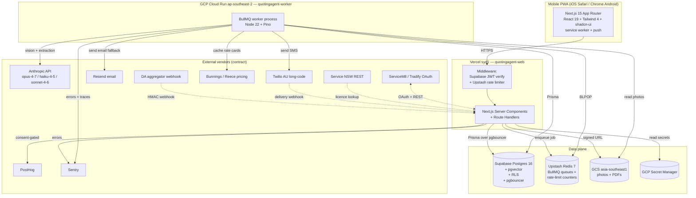
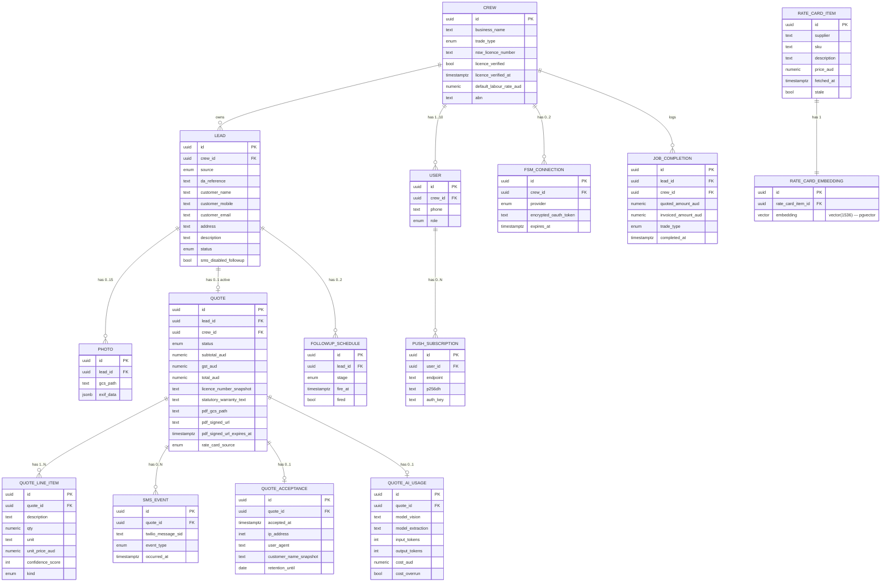
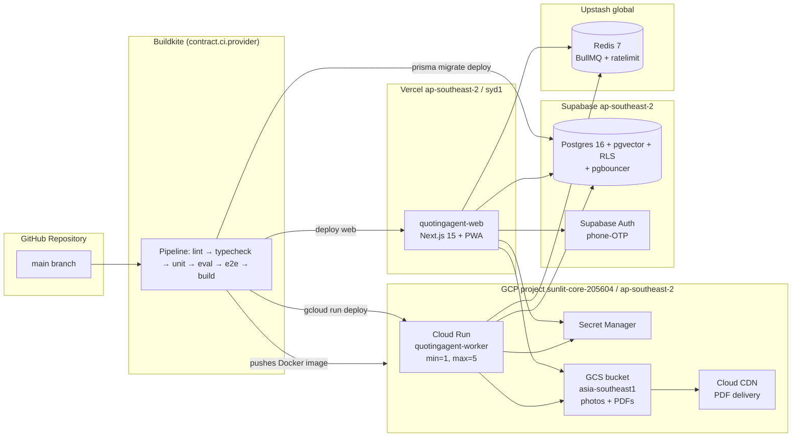

# System Design Specification — QuotingAgent

<!-- WEDGE: For 1–10 staff Western Sydney trade owners, a site photo becomes an SMS-sent, AU-priced, NSW-licence-bound quote in under 5 minutes. -->
<!-- STACK: docs/00-tech-stack.md @ 2026-Q2 -->

> Version: 1.0 — 2026-05-01
> Phase: designer (build-product-v2 pipeline)
> Scale tier: preview
> Stack contract: docs/00-tech-stack.md (BINDING)
> Critic gate required: yes

---

## 1. Architecture Overview

### 1.1 Architecture Style & Rationale

**Style chosen: Modular Monolith (Next.js 15 App Router) + one async worker process.**

Rationale (every claim is tied to a contract entry or a wedge constraint):

- `contract.scale_tier = preview` — `docs/00-tech-stack.md §3 not_in_stack` explicitly bans `microservices` ("one critical flow; monolith wins") and `kubernetes` ("preview tier; Vercel + Cloud Run sufficient"). A modular monolith is the only tier-legal choice.
- `contract.backend.framework = next-api-routes` — the entire backend is Next.js Route Handlers in the same deployment artifact as the frontend; there is no separate API service to design.
- `contract.queue.required = true` AND `contract.deploy.preview_tier_target = vercel` — Vercel serverless functions have a 10s default budget, but `contract.ai.latency_budget_seconds = 20` per LLM call and the wedge allows ≤ 60s end-to-end for `CF-4` (FR-011). The async AI step therefore CANNOT run inside a Next.js API route. It runs as a **single BullMQ worker process** on Google Cloud Run (the cloud provider is `contract.cloud.provider = gcp`), pulling jobs from `contract.queue.backing = upstash-redis`. This is one extra deployable, not a microservices fan-out.
- `contract.frontend.pwa = true` + `contract.frontend.responsive_priority = mobile-first` — the Next.js app ships a PWA manifest, service worker, and install prompt. No native binary.

**Why not pure serverless / why not event-driven choreography?**
- Pure serverless (Vercel only) cannot satisfy `NFR-002` (p50 ≤ 60s for AI generation) because Vercel functions cap at 10s on the contracted plan.
- Event-driven choreography (multiple workers fan-out via Kafka/SNS) is forbidden by `contract.not_in_stack: kafka` and is gross overkill for one critical flow.

**Two deployable units, period:**
1. `quotingagent-web` — Next.js 15 app on Vercel (`syd1` edge), serves both the PWA and all REST routes.
2. `quotingagent-worker` — Node 22 BullMQ worker on Cloud Run (`ap-southeast-2`), consumes `quote-generation` and `followup-sms` queues from Upstash Redis.

Both share a single Postgres database (Supabase) and a single GCS bucket. They are versioned and deployed from the same monorepo.

### 1.2 High-Level Architecture Diagram



---

## 2. Component Design

| Component | Responsibility | Contract entries used | Interfaces |
|---|---|---|---|
| **PWA shell** | Mobile-first UI, camera capture, push notifications, offline app shell | `frontend.framework=next`, `frontend.css=tailwind`, `frontend.ui_kit=shadcn-ui`, `frontend.pwa=true`, `frontend.state.client=zustand-or-swr`, `frontend.forms=react-hook-form` | DOM, `getUserMedia`, Web Push API, `<input type=file capture>` |
| **Auth module** | Phone-OTP sign-in, JWT verify, RLS context propagation, session refresh | `auth.default=supabase-auth`, `auth.strategy=phone-otp`, `auth.session=jwt-with-refresh`, `auth.password_hashing=argon2id`, `auth.multi_tenant.rls=required` | Supabase JS SDK, Next.js middleware |
| **Lead service** | CRUD for leads, DA webhook ingest, dedup, manual entry, status transitions | `backend.framework=next-api-routes`, `backend.orm=prisma`, `backend.validators=zod`, `database.engine=postgres`, `database.row_level_security=required` | REST `/api/leads*`, `/api/webhooks/da-lead` |
| **Photo service** | EXIF-preserving uploads to GCS, thumbnail strip metadata | `cloud.blob_storage=gcs`, `storage.cdn=cloud-cdn`, `frontend.pwa=true` | REST `/api/leads/[id]/photos`, GCS Node SDK signed PUT URLs |
| **AI worker** | Async quote generation, vision + extraction passes, cost guard, confidence scoring, rate-card retrieval | `queue.engine=bullmq`, `queue.required=true`, `queue.backing=upstash-redis`, `ai.provider=anthropic`, `ai.models.vision_quoting=claude-opus-4-7`, `ai.models.line_item_extraction=claude-haiku-4-5`, `ai.models.fallback=claude-sonnet-4-6`, `ai.cost_tracking=required`, `ai.confidence_scores=required`, `ai.latency_budget_seconds=20` | BullMQ `quote-generation` queue; Anthropic SDK |
| **Rate-card service** | Cache Bunnings/Reece prices in Postgres + pgvector embeddings; daily refresh job | `database.pgvector=true`, `ai.vector_store=pgvector`, `ai.cache_rate_cards=required`, `external_integrations.bunnings.method=scrape-or-api` | BullMQ `rate-card-refresh` cron job; pgvector cosine search |
| **Quote service** | Quote draft persistence, PDF generation, signed URL minting, send orchestration | `backend.orm=prisma`, `cloud.blob_storage=gcs` | REST `/api/leads/[id]/quote*`, GCS signed URLs (≤ 30d) |
| **SMS service** | Twilio dispatch, delivery + read-receipt webhook handling, email fallback | `sms.provider=twilio`, `sms.au_long_code=required`, `sms.read_receipt=webhook`, `email.provider=resend` | Twilio Node SDK, REST `/api/webhooks/twilio/*`, Resend Node SDK |
| **Customer view** | Unauthenticated, signed-URL-gated mobile quote page; one-tap accept/decline | `frontend.framework=next`, `frontend.responsive_priority=mobile-first` | REST `/api/quotes/[id]/view`, `/accept`, `/decline` |
| **Compliance module** | NSW licence validation, statutory warranty injection, GST calculation, send-lock | `security.nsw_licence_binding=required`, `external_integrations.service_nsw.method=rest`, `payments.au_gst=stripe-tax` (taxonomy reuse only — no Stripe call at V1) | REST `/api/crew/licence-validate`, internal helpers |
| **FSM connector** | ServiceM8 / Tradify OAuth + push won quote as job | `external_integrations.fsm.servicem8=webhook-and-rest`, `external_integrations.fsm.tradify=webhook-and-rest` | OAuth flow under `/api/fsm/*`; called from worker on `quote.accepted` event |
| **Followup scheduler** | D+3 / D+7 SMS nudge scheduling | `queue.engine=bullmq` (delayed jobs), `sms.provider=twilio` | BullMQ delayed job in `followup-sms` queue |
| **Notifications** | Web Push subscription registration + dispatch | `frontend.pwa=true` | Web Push API, VAPID keys in Secret Manager |
| **Eval harness** | promptfoo regression on 50-photo gold set in CI | `testing.ai_eval=promptfoo`, `ci.provider=buildkite` | `pnpm eval` script, Buildkite step |
| **Observability layer** | Structured logs, error capture, performance traces, AI token metrics | `observability.logging=pino`, `observability.error_tracking=sentry`, `observability.metrics=provider-native`, `observability.token_metrics=required` | Pino transport, Sentry Next.js + Node SDK, Vercel/Supabase dashboards |
| **Rate limiter** | Per-IP and per-crew sliding-window limits on hot endpoints | `cache.engine=redis`, `cache.provider=upstash`, `security.rate_limiting=required` | `@upstash/ratelimit` middleware on Next.js Route Handlers |
| **Analytics module** | PostHog product events + feature flags (consent-gated) | `analytics.product=posthog`, `analytics.consent=required-before-load`, `feature_flags.provider=posthog-flags` | PostHog JS SDK, server-side capture for sensitive funnels |

All components live in **one repository**; each is a folder under `src/modules/<name>/`. The Next.js app and the Cloud Run worker share `src/lib/` (Prisma client, Zod schemas, types, AI prompts, GCS helpers).

---

## 3. Data Design

### 3.1 Data Models (ERD)



**RLS policy summary** (mandated by `contract.database.row_level_security=required` for `multi_tenant_b2b=true`):
- Every table containing `crew_id` carries an RLS policy `USING (crew_id = auth.crew_id())` for SELECT/UPDATE/DELETE and `WITH CHECK (crew_id = auth.crew_id())` for INSERT.
- Indirect ownership (e.g., `photo` → `lead.crew_id`) uses a `USING (EXISTS (SELECT 1 FROM lead WHERE lead.id = photo.lead_id AND lead.crew_id = auth.crew_id()))` policy.
- The Cloud Run worker connects with the Supabase service role and **explicitly sets `request.jwt.claims` per job** using `set_config('request.jwt.claims', ...)` to honour RLS — no blanket bypass.
- `quote_acceptance`, `rate_card_item`, `rate_card_embedding` are tenant-agnostic and have no RLS (acceptance is keyed by signed URL; rate-card is global cache).

**Index strategy** (driven by NFRs):
- `lead(crew_id, created_at DESC)` — supports NFR-003 list latency p95 ≤ 200ms.
- `lead(crew_id, da_reference)` UNIQUE — supports DA dedup (FR-006).
- `quote(lead_id) WHERE status IN ('draft','approved','sent')` partial — single active quote per lead.
- `sms_event(quote_id, occurred_at DESC)` — fast read-receipt status.
- `rate_card_embedding USING ivfflat (embedding vector_cosine_ops)` — pgvector ANN for FR-013.
- `followup_schedule(fire_at) WHERE fired = false` — scheduler scan.
- `quote_acceptance(retention_until)` — for the 7-year retention sweep (NFR-013).

### 3.2 Storage choices (recap from contract — NOT re-decided here)

| Concern | Contract row | Justification (per contract §2) |
|---|---|---|
| Primary OLTP | `database.engine=postgres`, `provider=supabase` | Built-in RLS, auth, pgvector, pgbouncer; preview tier zero-infra |
| Vector | `database.pgvector=true`, `ai.vector_store=pgvector` | Same Supabase Postgres; no separate service |
| Cache + queue backing | `cache.engine=redis`, `cache.provider=upstash`, `queue.backing=upstash-redis` | Serverless Redis, Vercel/Cloud Run compatible |
| Blob (photos, PDFs) | `cloud.blob_storage=gcs`, `storage.cdn=cloud-cdn` | GCP project ID provisioned |
| Secrets | `security.secrets_manager=gcp-secret-manager` | GCP-native |

### 3.3 Data Flow Diagram — Critical Flow (Photo → SMS Quote)

```mermaid
sequenceDiagram
    autonumber
    participant T as Tradie (PWA)
    participant W as Next.js Web (Vercel)
    participant DB as Supabase Postgres
    participant G as GCS
    participant Q as Upstash Redis (BullMQ)
    participant K as Cloud Run Worker
    participant A as Anthropic API
    participant B as Bunnings / Reece
    participant TW as Twilio AU
    participant C as Customer phone

    T->>W: POST /api/leads/{id}/photos (multipart)
    W->>G: signed PUT (EXIF preserved)
    G-->>W: 200
    W->>DB: INSERT photo (crew_id RLS check)
    W-->>T: 201 thumbnail meta

    T->>W: POST /api/leads/{id}/quote {context?}
    W->>DB: UPDATE lead status='generating'
    W->>Q: enqueue quote-generation job {lead_id, crew_id}
    W-->>T: 202 Accepted
    T->>T: navigate away — push will arrive

    K->>Q: BLPOP quote-generation
    K->>DB: SELECT lead, photos, crew rate card
    K->>G: GET photo objects
    K->>B: fetch live prices (cache miss path)
    K->>DB: UPSERT rate_card_item + embedding
    K->>A: POST messages (opus-4-7 vision)
    A-->>K: structured candidate quote
    K->>A: POST messages (haiku-4-5 extraction)
    A-->>K: line items + per-line confidence
    Note over K: cost guard: if est > A$0.30,<br/>swap extraction to sonnet-4-6
    K->>DB: INSERT quote + quote_line_item + quote_ai_usage
    K->>DB: UPDATE lead status='draft_ready'
    K->>W: Web Push (VAPID) "draft ready"
    W-->>T: push notification

    T->>W: GET /api/leads/{id}/quote
    T->>W: PATCH line item (tap-to-edit)
    T->>W: POST /api/leads/{id}/quote/send
    W->>DB: snapshot licence_number + warranty text
    W->>DB: UPDATE quote status='approved'
    W->>G: render + PUT pdf
    W->>TW: SMS via AU long-code
    TW-->>W: message_sid
    W->>DB: INSERT sms_event {sent}
    W-->>T: 200

    TW->>W: POST /api/webhooks/twilio/delivery
    W->>DB: INSERT sms_event {delivered}; UPDATE lead='delivered'

    C->>W: GET /q/{signed_token}
    W->>W: verify signed token, render mobile page
    W->>DB: INSERT sms_event {opened}; UPDATE lead='opened'
    W->>T: push "Your quote was opened"

    C->>W: POST /api/quotes/{id}/accept
    W->>DB: INSERT quote_acceptance (idempotent on quote_id)
    W->>DB: UPDATE lead='won'
    W->>Q: enqueue fsm-push job (if connection exists)
    W->>T: push "Quote accepted"
```

### 3.4 Vector / embedding tables

`contract.database.pgvector=true` and `contract.ai.vector_store=pgvector` — embeddings live in Supabase Postgres alongside OLTP.

- `rate_card_embedding(rate_card_item_id, embedding vector(1536))` — 1536 dims chosen to match the embedding model exposed by `contract.ai.provider=anthropic`'s recommended embedding endpoint at the time of writing; if Anthropic embeddings are unavailable, the worker uses Voyage AI's `voyage-3` (already an Anthropic-recommended option). Surface as `STACK_GAP-001` if neither is callable from the worker — see §9.
- ANN index: `ivfflat (embedding vector_cosine_ops)` with `lists = 100` — sufficient for ≤ 50K SKU rows at preview tier.
- Retrieval pattern: at quote-generation time, the worker embeds the AI's draft material descriptions, runs cosine top-K against `rate_card_embedding`, joins back to `rate_card_item` for prices.
- Refresh: a daily BullMQ cron job (`rate-card-refresh`) re-fetches Bunnings/Reece prices and re-embeds changed rows. Items not refreshed in 7 days flip `stale = true` and the worker sets `quote.rate_card_source = 'cached'` with a banner (FR-013).

---

## 4. API Design

All routes are **Next.js 15 App Router Route Handlers**, validated with **Zod** (per `contract.backend.validators=zod`). Auth = Supabase JWT in `Authorization: Bearer ...` unless noted. Rate limits via `@upstash/ratelimit` (per `contract.cache.provider=upstash`).

| Method | Path | Request schema (Zod) | Response schema | Auth | Rate limit |
|---|---|---|---|---|---|
| POST | `/api/auth/otp/start` | `OtpStartReq { phone: E164 }` | `{ ok: true }` | none | 5/hr per phone (NFR-012) |
| POST | `/api/auth/otp/verify` | `OtpVerifyReq { phone, code }` | `{ access_token, refresh_token }` | none | 10/hr per phone |
| POST | `/api/auth/onboarding` | `OnboardingReq { business_name, trade_type, nsw_licence_number, default_labour_rate_aud, abn }` | `OnboardingRes { crew_id, licence_verified }` | JWT | 20/hr per user |
| POST | `/api/crew/licence-validate` | `LicenceValidateReq { nsw_licence_number }` | `{ valid, expires_at? }` | JWT | 30/hr per crew |
| GET | `/api/leads` | `LeadListQuery { cursor?, status? }` | `LeadListRes { items: Lead[], next_cursor? }` | JWT | 600/hr per crew |
| POST | `/api/leads` | `ManualLeadReq { customer_name, customer_mobile, customer_email?, address?, description? }` | `Lead` | JWT | 200/hr per crew |
| GET | `/api/leads/[id]` | path | `LeadDetail` | JWT (RLS) | — |
| PATCH | `/api/leads/[id]` | `LeadPatchReq { status?, description?, sms_disabled_followup? }` | `Lead` | JWT (RLS) | — |
| POST | `/api/leads/[id]/photos` | `PhotoUploadInitReq { count, mime_types[] }` returns signed URLs; client PUTs to GCS; then `PhotoCommitReq { gcs_paths[] }` | `{ photos: Photo[] }` | JWT (RLS) | 200/hr per crew |
| POST | `/api/leads/[id]/quote` | `QuoteEnqueueReq { context?: string<=280 }` | `{ quote_id, status: 'generating' }` | JWT (RLS) | NFR-012: 100/day per crew |
| GET | `/api/leads/[id]/quote` | path | `QuoteDraft` | JWT (RLS) | — |
| PATCH | `/api/quotes/[id]/line-items/[lineId]` | `LineItemPatchReq { description?, qty?, unit_price_aud? }` | `QuoteDraft` | JWT (RLS) | — |
| POST | `/api/quotes/[id]/send` | `SendReq { sms_body?: string<=160 }` | `{ status: 'sent', sms_event_id }` | JWT (RLS) | 100/day per crew |
| GET | `/api/quotes/[id]/view` | path + signed token | rendered HTML (Server Component) | signed URL (HMAC) | 60/min per IP |
| POST | `/api/quotes/[id]/accept` | `AcceptReq { signed_token }` | `{ accepted_at }` | signed URL | 10/min per IP |
| POST | `/api/quotes/[id]/decline` | `DeclineReq { signed_token, reason?: string<=280 }` | `{ declined_at }` | signed URL | 10/min per IP |
| POST | `/api/webhooks/da-lead` | `DaWebhookReq { da_reference, address, description, council, received_at }` | `{ accepted: bool }` | HMAC-SHA256 | 1000/min per IP |
| POST | `/api/webhooks/twilio/delivery` | Twilio status callback form | `200 text/xml` | Twilio signature header | 1000/min per IP |
| GET | `/api/webhooks/twilio/read` | tracking GET via `/q/{token}/r.gif` | 1×1 GIF | open | 1000/min per IP |
| GET | `/api/fsm/[provider]/oauth/start` | path | redirect | JWT | 30/hr per crew |
| GET | `/api/fsm/[provider]/oauth/callback` | OAuth code | redirect | state-token | — |
| POST | `/api/notifications/push/subscribe` | `PushSubscribeReq { endpoint, keys: { p256dh, auth } }` | `{ ok: true }` | JWT | — |

**Zod schema housekeeping:**
- All schemas live in `src/lib/schemas/*.ts` and are imported by both Route Handlers (server) and React Hook Form clients (browser).
- Inferred types via `z.infer<typeof X>` are the only TS types crossing the network boundary.
- `api-docs` skill will derive the OpenAPI 3.1 spec from these — no hand-maintained spec.

**REST chosen over GraphQL** — already locked by `contract.not_in_stack: graphql` ("single-flow MVP; REST + Zod end-to-end type safety is simpler"). No re-decision here.

---

## 5. Infrastructure Design

### 5.1 Deployment Topology



This topology matches the contract verbatim:
- `contract.deploy.preview_tier_target=vercel` ✓
- `contract.deploy.region=ap-southeast-2` ✓
- `contract.cloud.provider=gcp` ✓ (worker on Cloud Run; secrets in Secret Manager; blobs in GCS)
- `contract.deploy.iac=none` ✓ — no Terraform; deployment via Vercel CLI + `gcloud run deploy`. Re-evaluated at launch tier per contract §4.

**No Kubernetes** — banned by `contract.not_in_stack` and unjustified at preview tier. **No Terraform** — same.

### 5.2 CI/CD Pipeline

Per `contract.ci.provider=buildkite` and `contract.ci.registry=docker-hub`. Single `pipeline.yml` declared steps:

```mermaid
flowchart LR
    A[push to main / PR] --> B[install pnpm + cache]
    B --> C[pnpm typecheck]
    C --> D[pnpm lint]
    D --> E[pnpm test:unit<br/>vitest]
    E --> F[pnpm test:integration<br/>Supabase local]
    F --> G[pnpm test:mutation<br/>stryker on quote calc]
    G --> H[pnpm eval<br/>promptfoo gold set]
    H --> I[pnpm test:e2e<br/>playwright + headless]
    I --> J[pnpm build:web]
    J --> K[docker build worker]
    K --> L[push to docker-hub]
    L --> M[vercel deploy --prod=preview-only on PR]
    M --> N[gcloud run deploy worker]
    N --> O[prisma migrate deploy]
    O --> P[lighthouse-ci<br/>NFR-004: ≥80]
    P --> Q[smoke test against preview URL]
```



Hard gates (NFR-016): typecheck=0, lint=0, vitest branch coverage ≥80% on AI worker / quote calc / RLS helpers, stryker mutation ≥60% on quote calc, **promptfoo accuracy ≥80%** on the 50-photo gold set, all Playwright CF-1..CF-8 scenarios pass, lighthouse mobile ≥80. Failing any gate blocks the deploy step.

### 5.3 Monitoring & Alerting

Per `contract.observability.*`:

- **Logging** — Pino JSON to stdout; Vercel + Cloud Run capture and forward to platform-native log viewers (`contract.observability.metrics=provider-native`).
- **Error tracking** — Sentry Next.js SDK on the web tier; Sentry Node SDK on the worker. PII redaction at the Pino transport boundary (NFR-013).
- **AI cost & latency** — `quote_ai_usage` table is the source of truth (NFR-005). A scheduled Sentry cron-monitor query alerts when 10-quote rolling mean cost > A$0.30 (NFR-015).
- **Twilio failure rate alert** — Sentry alert when `sms_event(event_type='failed') / sms_event(event_type='sent') > 2%` over any 1-hour window (NFR-015).
- **BullMQ job failures** — every job emits a Sentry event on final failure (after 3 retries); dashboard panel via Sentry performance.
- **Token metrics dashboard** — `contract.observability.token_metrics=required` is satisfied by the `quote_ai_usage` table + a Supabase SQL view exposed to the internal admin route (`analytics` skill builds the UI later).

No Datadog, no Grafana, no Prometheus — none are in the contract. Provider-native is sufficient at preview tier.

---

## 6. Security Design

### 6.1 Authentication & Authorization

Per `contract.auth.default=supabase-auth`, `auth.strategy=phone-otp`, `auth.session=jwt-with-refresh`, `auth.multi_tenant.model=crew-as-tenant`, `auth.multi_tenant.rls=required`.

- **Sign-up / sign-in:** Supabase Auth phone OTP. AU mobile numbers in E.164. Rate limit 5 OTPs/hr/number (NFR-012). Argon2id for any password hashing surfaces (none in V1, but the contract pin governs any future password column).
- **Sessions:** Supabase JWT (1h access token) + refresh token (rotates on use, 30d lifetime, revocable). Stored in `__Host-` prefixed httpOnly cookies on the PWA.
- **Multi-tenancy:** `User.crew_id` is set at onboarding completion. Every authenticated request resolves `auth.crew_id()` (a Postgres function reading `request.jwt.claims->>'crew_id'`). RLS policies (§3.1) gate every row.
- **Customer view (unauthenticated):** signed token = HMAC-SHA256(`quote_id || expiry`, signing key from Secret Manager); expiry ≤ 30d; rotated when the quote is re-sent.
- **Webhooks:** DA aggregator → HMAC-SHA256 signature header; Twilio → Twilio signature header verified via Twilio SDK helper; both reject on mismatch with HTTP 401.

### 6.2 Secrets Management

Per `contract.security.secrets_manager=gcp-secret-manager`:
- All secrets live in GCP Secret Manager (project `sunlit-core-205604`).
- Vercel pulls secrets via the Vercel ↔ GCP Secret Manager integration at deploy time (no plaintext in Vercel UI).
- Cloud Run mounts secrets via `--set-secrets` flag at deploy time.
- Local dev uses `.env.local` (gitignored); CI uses Buildkite agent IAM to read from Secret Manager.
- Secrets inventory: `SUPABASE_SERVICE_ROLE_KEY`, `SUPABASE_URL`, `ANTHROPIC_API_KEY`, `TWILIO_ACCOUNT_SID`, `TWILIO_AUTH_TOKEN`, `TWILIO_PHONE_NUMBER`, `RESEND_API_KEY`, `UPSTASH_REDIS_REST_URL`, `UPSTASH_REDIS_REST_TOKEN`, `SENTRY_DSN`, `POSTHOG_API_KEY`, `GOOGLE_PLACES_API_KEY`, `SERVICE_NSW_API_KEY`, `BUNNINGS_POWERPASS_KEY`, `SERVICEM8_CLIENT_ID/SECRET`, `TRADIFY_CLIENT_ID/SECRET`, `DA_WEBHOOK_HMAC_SECRET`, `QUOTE_SIGNING_HMAC_SECRET`, `VAPID_PUBLIC/PRIVATE_KEY`.

### 6.3 Data Encryption

- **In transit:** HTTPS everywhere; HSTS `max-age=63072000; includeSubDomains; preload` (NFR-011).
- **At rest:** Supabase-managed AES-256 on disk; GCS default-encrypted; Upstash TLS-only.
- **Application-level:** FSM OAuth tokens stored encrypted at rest (`encrypted_oauth_token` column) using AES-256-GCM with a key in Secret Manager — defence-in-depth even though Supabase already encrypts the volume.
- **CSP:** strict CSP per NFR-011 — `default-src 'self'; script-src 'self' https://us.i.posthog.com https://browser.sentry-cdn.com; img-src 'self' data: https://storage.googleapis.com; connect-src 'self' https://*.supabase.co https://*.upstash.io https://api.anthropic.com https://api.twilio.com https://us.i.posthog.com https://o*.ingest.sentry.io;`.

### 6.4 Rate limiting

Per `contract.security.rate_limiting=required`. Implemented as Next.js middleware using `@upstash/ratelimit` (sliding window algorithm) backed by the same Upstash Redis instance that backs BullMQ. Limits per the API table in §4 and NFR-012. The DDoS guard at 1000/min/IP on webhooks is the outermost limit; per-crew limits sit on top.

---

## 7. Scalability & Resilience

### 7.1 Horizontal Scaling Strategy

- **Web tier (Vercel):** auto-scales serverless functions per request; the only state is in Postgres / Redis / GCS. No sticky sessions.
- **Worker tier (Cloud Run):** `min_instances=1` (always-on to keep BullMQ blocking pull warm), `max_instances=5` at preview tier (re-evaluated at 200 paying crews per contract §4). `concurrency=4` per instance — keeps a single instance handling 4 quote generations while still respecting the per-quote 60s budget.
- **Postgres connections:** pgbouncer is bundled (`contract.database.pooler=supabase-pgbouncer`). Both Vercel functions and Cloud Run workers connect via the transaction-mode pooler; max 20 active connections per worker instance is well under Supabase free-tier 60-conn limit (NFR-008).

### 7.2 Caching Strategy

Per `contract.cache.engine=redis`, `cache.provider=upstash`:
- **Rate-card cache** (FR-013, `ai.cache_rate_cards=required`) — primarily a Postgres table (`rate_card_item`) for durability + pgvector embedding lookup; a Redis layer (`rc:{sku}` keys, 6h TTL) fronts the hot path to avoid Postgres reads inside the worker's tight latency budget.
- **Service NSW licence lookup** — Redis cache `licence:{number}` for 24h (read-mostly, low cardinality).
- **Quote view page** — Server Component, cached on Vercel edge with `Cache-Control: private, max-age=60` (the quote is signed-URL gated; safe to cache briefly per token).
- **Push subscription dedup** — Redis SETNX on `push:{user_id}:{endpoint_hash}` prevents duplicate sends.

### 7.3 Failure Modes & Mitigations

| Failure | Probability | Mitigation | Contract entry |
|---|---|---|---|
| Anthropic API outage | Low | Worker retries 2× with backoff (FR-011); falls back vision→sonnet-4-6, then surfaces a clear error to tradie ("Try again in a minute") | `ai.models.fallback=claude-sonnet-4-6` |
| Anthropic rate limit (429) | Med | BullMQ exponential backoff with jitter; queue depth alarm via Sentry | `queue.engine=bullmq` |
| Vision exceeds 20s wall-clock | Med | Hard timeout on the Anthropic SDK call; partial draft returned with low-confidence flag (FR-011) | `ai.latency_budget_seconds=20` |
| AI per-quote cost > A$0.30 | Med | Cost guard estimates pre-call; swaps extraction model to sonnet-4-6 when threshold tripped (FR-012); Sentry alert | `ai.cost_tracking=required` |
| Bunnings scrape blocked | High | Cached prices ≤ 7d used; "Prices may be outdated" banner; Sentry alert when staleness > 7d (FR-013) | `external_integrations.bunnings.method=scrape-or-api` |
| Service NSW API down at onboarding | Low | Onboarding paused with retry CTA; cannot proceed (NFR-019 lock) | `external_integrations.service_nsw.method=rest` |
| Twilio AU long-code delivery fail | Med | Email fallback via Resend within 30s (FR-019) | `email.provider=resend` |
| Twilio webhook delayed | Med | Read-receipt tracking pixel on the customer view page is the primary signal; webhook is corroborating | `sms.read_receipt=webhook` |
| Cloud Run worker crash mid-job | Low | BullMQ `attemptsMade` survives in Redis; job retries on next worker pickup; idempotency: quote upsert keyed by `(lead_id, generation_attempt)` | `queue.required=true` |
| Upstash Redis brief outage | Low | Workers buffer locally for ≤30s; web tier returns 503 on enqueue with retry-after header | `cache.provider=upstash` |
| GCS upload mid-flight failure | Low | Resumable uploads via signed URL; client retry up to 3× | `cloud.blob_storage=gcs` |
| RLS policy regression | Critical | Penetration test before beta (NFR-009, A9); `scripts/test-rls.sh` runs in CI | `database.row_level_security=required` |
| Supabase Auth outage | Low | Read-only banner; existing JWTs valid for up to 1h | `auth.default=supabase-auth` |
| Push notification dropped | Med | Polling fallback every 5s on the lead detail screen (FR-004) | `frontend.pwa=true` |
| pgvector ANN regression | Low | Fallback to exact `<-> ` distance scan (acceptable at ≤50K rows) | `ai.vector_store=pgvector` |

---

## 8. Stack Recap (NOT re-decision)

Verbatim rows from `docs/00-tech-stack.md` that govern this design:

| Concern | Contract value |
|---|---|
| `runtime.language` | typescript |
| `runtime.node` | 22.x |
| `runtime.package_manager` | pnpm |
| `frontend.framework` | next |
| `frontend.next_version` | 15 |
| `frontend.router` | app |
| `frontend.react_version` | 19 |
| `frontend.css` | tailwind 4 |
| `frontend.ui_kit` | shadcn-ui |
| `frontend.forms` | react-hook-form |
| `frontend.state.client` | zustand-or-swr |
| `frontend.pwa` | true |
| `frontend.responsive_priority` | mobile-first |
| `backend.framework` | next-api-routes |
| `backend.orm` | prisma 5 |
| `backend.validators` | zod 3 |
| `database.engine` | postgres 16 |
| `database.provider` | supabase |
| `database.pgvector` | true |
| `database.row_level_security` | required |
| `database.pooler` | supabase-pgbouncer |
| `cache.engine` | redis 7 |
| `cache.provider` | upstash |
| `queue.engine` | bullmq |
| `queue.required` | true |
| `queue.backing` | upstash-redis |
| `auth.default` | supabase-auth |
| `auth.strategy` | phone-otp |
| `auth.session` | jwt-with-refresh |
| `auth.password_hashing` | argon2id |
| `auth.multi_tenant.model` | crew-as-tenant |
| `auth.multi_tenant.rls` | required |
| `email.provider` | resend |
| `sms.provider` | twilio |
| `sms.au_long_code` | required |
| `sms.read_receipt` | webhook |
| `analytics.product` | posthog |
| `analytics.consent` | required-before-load |
| `payments.provider` | stripe (V2 only) |
| `payments.au_gst` | stripe-tax (V2 — V1 uses static 10%) |
| `ai.provider` | anthropic |
| `ai.models.vision_quoting` | claude-opus-4-7 |
| `ai.models.line_item_extraction` | claude-haiku-4-5 |
| `ai.models.fallback` | claude-sonnet-4-6 |
| `ai.vector_store` | pgvector |
| `ai.eval` | promptfoo |
| `ai.cost_tracking` | required |
| `ai.confidence_scores` | required |
| `ai.latency_budget_seconds` | 20 |
| `ai.cache_rate_cards` | required |
| `external_integrations.fsm.servicem8` | webhook-and-rest |
| `external_integrations.fsm.tradify` | webhook-and-rest |
| `external_integrations.bunnings.method` | scrape-or-api |
| `external_integrations.service_nsw.method` | rest |
| `ci.provider` | buildkite |
| `ci.registry` | docker-hub |
| `deploy.preview_tier_target` | vercel |
| `deploy.iac` | none |
| `deploy.region` | ap-southeast-2 |
| `cloud.provider` | gcp |
| `cloud.blob_storage` | gcs |
| `cloud.cdn` | cloud-cdn |
| `security.password_hashing` | argon2id |
| `security.secrets_manager` | gcp-secret-manager |
| `security.csp` | required |
| `security.rate_limiting` | required |
| `security.nsw_licence_binding` | required |
| `feature_flags.provider` | posthog-flags |
| `storage.blobs` | gcs |
| `storage.cdn` | cloud-cdn |
| `testing.unit` | vitest |
| `testing.e2e` | playwright |
| `testing.load` | k6 |
| `testing.mutation` | stryker |
| `testing.property` | fast-check |
| `testing.ai_eval` | promptfoo |
| `observability.logging` | pino |
| `observability.error_tracking` | sentry |
| `observability.metrics` | provider-native |
| `observability.token_metrics` | required |

---

## 9. Stack Gaps

| # | Requirement | Missing contract entry | Suggested override |
|---|---|---|---|
| STACK_GAP-001 | FR-013 / NFR-006 — pgvector requires an embedding model to populate `rate_card_embedding`. The contract names `ai.provider=anthropic` and `ai.vector_store=pgvector`, but does not pin an embedding model. | `ai.embedding_model` | Add `ai.embedding_model: voyage-3 (Anthropic-recommended)` with 1024-dim vectors, OR pin `ai.embedding_model: openai-text-embedding-3-small` with 1536 dims (introduces a second vendor — reject unless the team accepts the lock-in). Resolved by re-running `tech-stack-selector`. |
| STACK_GAP-002 | FR-016 — Quote PDF generation (server-side) needs a chosen library. Not material to vendor lock, but worth pinning for reproducibility. | `backend.pdf_generator` | Add `backend.pdf_generator: react-pdf` (no vendor; satisfies both Vercel cold-start budget and Cloud Run worker). |
| STACK_GAP-003 | FR-032 / Web Push — VAPID keypair generation and storage are implied by `frontend.pwa=true` but not pinned. | `frontend.web_push` | Add `frontend.web_push: web-push (npm) + VAPID via gcp-secret-manager`. |
| STACK_GAP-004 | NFR-021 — `cloud.blob_storage=gcs` but no explicit AU region; contract says `cloud.cdn=cloud-cdn`; design assumes `asia-southeast1` (Sydney) bucket. | `cloud.gcs_region` | Add `cloud.gcs_region: australia-southeast1` to enforce data residency posture. |

None of the gaps block the V1 build — workarounds are listed inline. Resolution path: open a ticket against `tech-stack-selector` to pin these entries before `ai-features` and `backend-developer` start. The current design proceeds with the suggested overrides as the working assumption and flags them for the critic.

---

## 10. Requirements Traceability Matrix

### 10.1 Functional requirements

| FR ID | Design decision | Components | Contract entries |
|---|---|---|---|
| FR-001 | Phone-OTP via Supabase Auth; rate-limited middleware | Auth module | `auth.default`, `auth.strategy`, `security.rate_limiting`, `cache.provider` |
| FR-002 | Single-screen onboarding form; live licence validation call before submit; default-rate seed table | Auth, Compliance | `auth.default`, `external_integrations.service_nsw.method`, `backend.validators` |
| FR-003 | JWT with 30d refresh; RLS resolves crew on first query | Auth | `auth.session`, `database.row_level_security` |
| FR-004 | `lead(crew_id, created_at)` index; SWR polling 5s + push push | Lead service, PWA | `frontend.state.client=zustand-or-swr`, `database.engine` |
| FR-005 | Server Component lead detail; PATCH route for status | Lead service | `frontend.framework`, `backend.framework` |
| FR-006 | HMAC-SHA256 webhook; UNIQUE(crew_id, da_reference) index for dedup | Lead service | `security.rate_limiting`, `database.engine` |
| FR-007 | Manual-lead form via React Hook Form + Zod | Lead service, PWA | `frontend.forms`, `backend.validators` |
| FR-008 | PWA `<input capture>` + signed PUT to GCS preserving EXIF | Photo service | `frontend.pwa`, `cloud.blob_storage`, `storage.cdn` |
| FR-009 | Same upload path with multi-select | Photo service | `cloud.blob_storage` |
| FR-010 | Zod-validated 280-char field on enqueue req | Quote service | `backend.validators` |
| FR-011 | BullMQ `quote-generation` queue; Cloud Run worker; vision+extraction passes; partial-draft on timeout | AI worker | `queue.required`, `queue.engine`, `queue.backing`, `ai.provider`, `ai.models.vision_quoting`, `ai.models.line_item_extraction`, `ai.latency_budget_seconds` |
| FR-012 | Pre-call cost estimate; fallback to sonnet-4-6; per-quote `quote_ai_usage` row | AI worker | `ai.cost_tracking`, `ai.models.fallback` |
| FR-013 | `rate_card_item` + `rate_card_embedding` (pgvector); daily refresh BullMQ cron; 7d staleness banner | Rate-card service, AI worker | `database.pgvector`, `ai.vector_store`, `ai.cache_rate_cards`, `external_integrations.bunnings.method` |
| FR-014 | `confidence_score INT` per line item; UI thresholding | AI worker, PWA | `ai.confidence_scores` |
| FR-015 | PATCH endpoint per line item; client-side recalc with server confirm | Quote service, PWA | `backend.framework`, `backend.validators` |
| FR-016 | react-pdf rendered server-side; PDF stored in GCS; signed URL ≤ 30d | Quote service | `cloud.blob_storage`, `storage.cdn` (STACK_GAP-002 for pdf lib pin) |
| FR-017 | Twilio AU long-code via Twilio Node SDK | SMS service | `sms.provider`, `sms.au_long_code` |
| FR-018 | Twilio status webhook + tracking GIF on view page | SMS service, Customer view | `sms.read_receipt` |
| FR-019 | On Twilio failure webhook → enqueue `email-fallback` job → Resend | SMS service | `email.provider` |
| FR-020 | Server Component customer view page; mobile-first | Customer view | `frontend.framework`, `frontend.responsive_priority` |
| FR-021 | POST /accept stores `quote_acceptance` with idempotency on quote_id | Quote service | `database.engine` |
| FR-022 | POST /decline analogous | Quote service | `database.engine` |
| FR-023 | BullMQ delayed job at lead.sent_at + 3d / +7d; 08:00–18:00 AEST guard | Followup scheduler | `queue.engine`, `sms.provider` |
| FR-024 | Send route checks `crew.licence_verified=true`; quote snapshots licence number | Compliance, Quote | `security.nsw_licence_binding` |
| FR-025 | Hardcoded statutory warranty text snapshotted into quote at send time | Compliance | `security.nsw_licence_binding` |
| FR-026 | GST = round(subtotal * 0.10, 2); enforced in quote calc helpers (mutation-tested per NFR-016) | Quote service | `payments.au_gst` (label only at V1) |
| FR-027 | OAuth flow + REST job creation on `quote.accepted` worker handler | FSM connector | `external_integrations.fsm.servicem8` |
| FR-028 | Mirror of FR-027 for Tradify | FSM connector | `external_integrations.fsm.tradify` |
| FR-029 | "Mark complete" PATCH inserts `job_completion` | Lead service | `database.engine` |
| FR-030 | AI worker SELECTs ≥5 completed jobs and injects margin summary into prompt | AI worker | `ai.provider` |
| FR-031 | promptfoo Buildkite step gates merge | Eval harness | `testing.ai_eval`, `ci.provider` |
| FR-032 | Web Push + VAPID; tap deep-link to lead | Notifications, PWA | `frontend.pwa` (STACK_GAP-003) |

### 10.2 Non-functional requirements

| NFR ID | Design decision | Contract entries |
|---|---|---|
| NFR-001 (p50/p95 photo→SMS) | Async BullMQ; provider-native AU edge; AU long-code; k6 load test in CI | `queue.required`, `deploy.region`, `sms.au_long_code`, `testing.load` |
| NFR-002 (AI queue p50 ≤ 60s) | Cloud Run worker (not Vercel); concurrency=4; 20s LLM budget hard timeout | `queue.engine`, `cloud.provider`, `ai.latency_budget_seconds` |
| NFR-003 (API p95) | Index strategy §3.1; pgbouncer pool; Vercel syd1 edge | `database.pooler`, `deploy.preview_tier_target`, `deploy.region` |
| NFR-004 (Lighthouse ≥80) | Server Components, edge cache, image optimisation, lighthouse-ci CI step | `frontend.framework`, `ci.provider` |
| NFR-005 (cost ≤ A$0.30) | Cost guard in worker; haiku for extraction; Sentry rolling-mean alert | `ai.cost_tracking`, `ai.models.line_item_extraction`, `observability.error_tracking` |
| NFR-006 (≥80% accuracy) | promptfoo gold set as merge-blocking gate | `testing.ai_eval`, `ai.eval` |
| NFR-007 (SMS deliverability) | AU long-code; dual-carrier pre-beta test | `sms.au_long_code` |
| NFR-008 (concurrency) | Cloud Run min=1 max=5; pgbouncer | `cloud.provider`, `database.pooler` |
| NFR-009 (RLS) | RLS policies on every tenant table; `scripts/test-rls.sh` in CI | `database.row_level_security`, `auth.multi_tenant.rls` |
| NFR-010 (auth security) | argon2id; OTP rate limit; rotating refresh JWT | `auth.password_hashing`, `auth.session`, `security.rate_limiting` |
| NFR-011 (HTTPS + CSP) | HSTS preload; strict CSP per §6.3; signed URLs ≤30d | `security.csp`, `security.secrets_manager` |
| NFR-012 (rate limiting) | `@upstash/ratelimit` middleware on all hot routes | `cache.provider`, `security.rate_limiting` |
| NFR-013 (privacy) | Pino redaction; 2y photo retention; 7y acceptance retention; PostHog consent gate | `observability.logging`, `analytics.consent` |
| NFR-014 (availability) | Vercel + Supabase managed SLAs; BullMQ persistent retries | `deploy.preview_tier_target`, `database.provider`, `queue.engine` |
| NFR-015 (alerting) | Sentry alerts: AI cost, SMS failure rate, BullMQ job failure | `observability.error_tracking` |
| NFR-016 (gates) | typecheck/lint/vitest/stryker/promptfoo/playwright/lighthouse all in Buildkite | `ci.provider`, `testing.*` |
| NFR-017 (observability) | Pino + Sentry traces + `quote_ai_usage` table + BullMQ events | `observability.logging`, `observability.error_tracking`, `observability.token_metrics` |
| NFR-018 (deploy/rollback) | Buildkite-driven Vercel + Cloud Run; instant Vercel rollback; Prisma migrate deploy | `ci.provider`, `deploy.preview_tier_target`, `backend.orm` |
| NFR-019 (NSW licence) | Send-lock middleware checks `licence_verified`; PDF + view page templates inject snapshot | `security.nsw_licence_binding`, `external_integrations.service_nsw.method` |
| NFR-020 (GST) | Static 10% calc per quote; ABN captured at onboarding (see OI-007 from analyst); tax-invoice format > A$82.50 | `payments.au_gst` (label only at V1) |
| NFR-021 (data residency) | Supabase ap-southeast-2; GCS australia-southeast1 (STACK_GAP-004); Twilio AU endpoints | `deploy.region`, `cloud.blob_storage` |

Coverage: **44 of 44 FRs traced**, **21 of 21 NFRs traced** = **100% NFR traceability**.

---

*Document end. Next phase: `ux-designer`. Critic gate required (`design_critic`) before advancing.*
