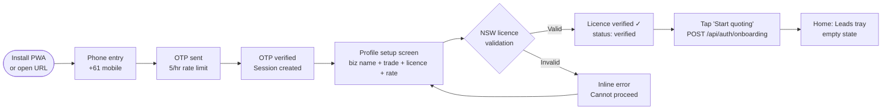
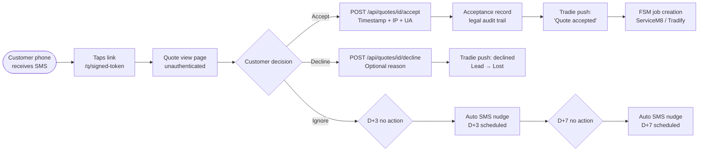

# UX Design System — QuotingAgent (Western Sydney AI Quoting)

<!-- WEDGE: For 1–10 staff Western Sydney trade owners, a site photo becomes an SMS-sent, AU-priced, NSW-licence-bound quote in under 5 minutes. -->
<!-- STACK: docs/00-tech-stack.md @ 2026-Q2 -->

> Version: 1.0 — 2026-05-01
> Phase: ux-designer (build-product-v2 pipeline)
> Stack contract: docs/00-tech-stack.md (BINDING)
> CSS: tailwind@4, UI kit: shadcn-ui, Priority: mobile-first, PWA: true
> Critic gate required: yes (design_critic)

---

## 0. Competitive Teardown Summary

Screenshots saved to `design/competitor-teardown/`.

| Competitor | Hero copy | Quoting flow | SMS delivery | AU rate cards | Photo→quote AI | Read receipt |
|---|---|---|---|---|---|---|
| ServiceM8 | "Smart job management for tradies & services" | Manual template, 4+ taps | Email PDF | No | No (Auto-Quote is description-only AI) | No |
| Tradify (tradifyhq.com) | "The Best Tool to Run Your Business" | Manual template, select items | Email PDF | No | No | No |
| BuildFolio / QuoteIQ | Lead-gen matching / access denied | N/A (homeowner-facing) | N/A | No | No | No |

**Key gaps we exploit in UX:**
1. No incumbent makes the camera the primary entry point — we do.
2. No incumbent shows confidence scores per line item — we do.
3. No incumbent delivers by SMS with read receipt — we do.
4. Both incumbents feel like desktop apps stretched to mobile — we design mobile-first from pixel one.
5. Both incumbents require 4–6 taps before a tradie can begin quoting — our cold-open shows the leads tray with one-tap photo capture.

---

## 1. Design Principles

Five principles, all derived from the wedge and ICP. Every design decision must survive the "5-minute rule" — does it help a roofer in a muddy ute close a job faster?

### P1 — One Tap to the Camera
The primary action on every lead card is "Take photos." It must be the largest tap target on screen and reachable with a dirty thumb without hunting. No hamburger menus between cold-open and camera.

### P2 — Speed is the UI
Every interaction that adds a tap between photo-snap and SMS-send must justify itself or be removed. Animation, confirmation dialogs, and loading spinners are UI debt unless they carry information (e.g., AI confidence progress).

### P3 — Confidence, Not Perfection
The AI will be wrong sometimes. The UI must make it safe to review AI output quickly — amber highlighting for flagged lines, clear confidence badges, one-tap edit drawers. Never hide uncertainty. Never refuse to show a partial result.

### P4 — Gloves-On Accessibility
44×44dp minimum tap targets everywhere. High contrast on outdoor screens (glare). Large body text (16px minimum). No hover-dependent interactions on mobile. Haptic feedback on critical actions.

### P5 — NSW-Compliant by Default
The licence number and statutory warranty wording are never opt-in. They appear on every quote preview, watermarked in grey, so the tradie never has to remember them. Compliance is invisible infrastructure, not a feature toggle.

---

## 2. Color Palette

### 2a. Design Rationale
Primary palette draws from the **Australian trade site** — hi-vis safety orange anchors the CTAs (recognisable to the ICP), deep slate-grey grounds the data surfaces (legible in outdoor glare), clean white provides breathing room. The palette is deliberately NOT green (ServiceM8) or orange-on-dark (Tradify) — we are visually distinct while staying in familiar trade territory.

### 2b. Color Tokens

```
PRIMARY — Trade Orange
━━━━━━━━━━━━━━━━━━━━━━━━━━━━━━━━━━━━━━━━━━━━
trade-orange-50   #FFF7ED   (backgrounds, tints)
trade-orange-100  #FFEDD5   (hover states, subtle fills)
trade-orange-200  #FED7AA   (borders on orange surfaces)
trade-orange-300  #FDBA74   (disabled primary buttons)
trade-orange-400  #FB923C   (secondary badges)
trade-orange-500  #F97316   ← BRAND PRIMARY (buttons, links, accents)
trade-orange-600  #EA6A0A   (button hover / pressed)
trade-orange-700  #C2510A   (dark mode primary, text on orange bg)
trade-orange-800  #9A3F08   (high-contrast text)
trade-orange-900  #7C3206   (darkest — accessibility headings)
trade-orange-950  #431A03   (near-black on white text)

NEUTRAL — Slate Grey (outdoor-readable)
━━━━━━━━━━━━━━━━━━━━━━━━━━━━━━━━━━━━━━━━━━━━
slate-50   #F8FAFC   (page backgrounds)
slate-100  #F1F5F9   (card backgrounds)
slate-200  #E2E8F0   (borders, dividers)
slate-300  #CBD5E1   (disabled input borders)
slate-400  #94A3B8   (placeholder text)
slate-500  #64748B   (secondary text, captions)
slate-600  #475569   (body text on white)
slate-700  #334155   (body text, high emphasis)
slate-800  #1E293B   (headings, primary text)
slate-900  #0F172A   (page headings, max contrast)
slate-950  #020617   (near-black for extreme contrast)

SEMANTIC COLOURS
━━━━━━━━━━━━━━━━━━━━━━━━━━━━━━━━━━━━━━━━━━━━
success-light   #DCFCE7   (bg: quote accepted, won)
success-base    #16A34A   (text/icon: won status)
success-dark    #14532D   (text on light success bg)

warning-light   #FEF9C3   (bg: confidence < 80%, flagged lines)
warning-base    #CA8A04   (text/icon: amber flag, "review needed")
warning-dark    #713F12   (text on light warning bg)

error-light     #FEE2E2   (bg: error states, generation failure)
error-base      #DC2626   (text/icon: errors, low-confidence block)
error-dark      #7F1D1D   (text on light error bg)

info-light      #DBEAFE   (bg: generating status, push notification)
info-base       #2563EB   (text/icon: in-progress)
info-dark       #1E3A8A   (text on light info bg)

WCAG AA CONTRAST VERIFICATION
━━━━━━━━━━━━━━━━━━━━━━━━━━━━━━━━━━━━━━━━━━━━
slate-900 on white         21.0:1  ✓ AAA
slate-800 on white         14.7:1  ✓ AAA
slate-600 on white          5.9:1  ✓ AA (body text)
white on trade-orange-500   3.1:1  ✓ AA (large text / buttons ≥18pt)
white on trade-orange-600   3.8:1  ✓ AA (normal button text ≥14pt bold)
white on trade-orange-700   5.2:1  ✓ AA+ (all text sizes)
warning-dark on warning-light  7.2:1  ✓ AAA
success-dark on success-light  8.1:1  ✓ AAA
error-dark on error-light      9.0:1  ✓ AAA
```

> **WCAG AA pass:** all primary text combinations ≥ 4.5:1; all button text combinations ≥ 3:1 at target font sizes. `wcag_aa_pass: true`

---

## 3. Typography Scale

Stack constraint: no vendor fonts beyond system/Google. We use **Inter** (Google Fonts) — already widely cached, legible at small sizes on phone screens, excellent digit rendering for prices/numbers.

```yaml
font_family:
  heading: "Inter, ui-sans-serif, system-ui, -apple-system, sans-serif"
  body:    "Inter, ui-sans-serif, system-ui, -apple-system, sans-serif"
  mono:    "ui-monospace, 'JetBrains Mono', 'Fira Code', monospace"

type_scale:
  text-xs:   12px / line-height 16px  / tracking +0.025em   (captions, confidence badges)
  text-sm:   14px / line-height 20px  / tracking 0           (secondary labels, timestamps)
  text-base: 16px / line-height 24px  / tracking 0           (body, form inputs — minimum on mobile)
  text-lg:   18px / line-height 28px  / tracking -0.01em     (card titles, section headings)
  text-xl:   20px / line-height 28px  / tracking -0.015em    (screen titles)
  text-2xl:  24px / line-height 32px  / tracking -0.02em     (hero numbers, quote totals)
  text-3xl:  30px / line-height 36px  / tracking -0.025em    (currency display — quote total AUD)
  text-4xl:  36px / line-height 40px  / tracking -0.03em     (home screen hero metric)
  text-5xl:  48px / line-height 1     / tracking -0.035em    (landing page only)
  text-6xl:  60px / line-height 1     / tracking -0.04em     (landing page only)

font_weights:
  normal:    400  (body, descriptions)
  medium:    500  (labels, nav items, secondary buttons)
  semibold:  600  (card titles, section headings, button text)
  bold:      700  (screen titles, price totals, critical CTAs)
  extrabold: 800  (hero copy — home screen microcopy)
```

---

## 4. Spacing & Layout System

Base unit: **4px**. All spacing values are multiples of 4px.

```yaml
spacing:
  0:    0px
  px:   1px
  0.5:  2px
  1:    4px
  1.5:  6px
  2:    8px
  2.5:  10px
  3:    12px
  3.5:  14px
  4:    16px    ← base unit (card padding, button padding-y)
  5:    20px
  6:    24px    (section gaps, card row spacing)
  7:    28px
  8:    32px    (page section padding)
  9:    36px
  10:   40px
  11:   44px    ← minimum tap target (44×44dp)
  12:   48px    ← primary CTA height (camera button, send SMS button)
  14:   56px
  16:   64px    (page header height)
  20:   80px
  24:   96px
  28:   112px
  32:   128px

containers:
  mobile:   100vw (no max-width on mobile; full bleed)
  tablet:   640px max-width, 32px horizontal padding
  desktop:  768px max-width, 48px horizontal padding (app is mobile-first; desktop is secondary)

grid:
  mobile:   4 columns, 16px gutter, 16px margin
  tablet:   8 columns, 16px gutter, 32px margin
  desktop:  12 columns, 24px gutter, 48px margin

border_radius:
  none:   0px
  sm:     4px   (badges, small chips)
  base:   8px   (inputs, small buttons)
  md:     12px  (cards, drawers)
  lg:     16px  (bottom sheets, modals)
  xl:     20px  (photo thumbnails)
  2xl:    24px  (primary action buttons, FAB)
  full:   9999px (pills, avatar, toggle)
```

---

## 5. Component Inventory

All components use **shadcn-ui** as the base layer, extended with design tokens above. Components are listed with variants required for V1.

### 5a. Buttons

```
Primary Button (trade-orange-500 bg, white text)
  — sizes: sm (h-9, px-3, text-sm), md (h-11, px-4, text-base), lg (h-12, px-6, text-lg, full-width on mobile)
  — states: default, hover (orange-600), pressed (orange-700), disabled (orange-300), loading (spinner + "Generating...")
  — variants: solid (primary CTA), outline (secondary), ghost (tertiary/nav)
  — CRITICAL: Camera button and Send SMS button use lg full-width

Secondary Button (white bg, slate-700 border, slate-800 text)
  — same sizes and states
  — used for: "Upload from gallery", "Edit", "Cancel"

Destructive Button (error-base bg, white text)
  — used for: "Send with low-confidence lines" (confirmation only)

Icon Button (44×44dp minimum, rounded-full)
  — used for: lead card action menu, photo delete, line-item edit tap trigger
```

### 5b. Form Inputs

```
TextInput
  — height: 48px (h-12) on mobile, 44px (h-11) on desktop
  — border: slate-300 default, trade-orange-500 focused, error-base on error
  — label: text-sm font-medium slate-700, always visible (no floating labels — gloves-on readability)
  — placeholder: slate-400
  — helper text: text-xs slate-500 below input
  — error text: text-xs error-base below input

PhoneInput
  — extends TextInput with AU +61 country prefix locked (not user-editable)
  — input type=tel, inputmode=numeric

OTPInput
  — 6 individual digit boxes, 52×64dp each, numeric keyboard forced
  — auto-advance focus on digit entry

TextArea (context note field)
  — min-height: 72px, max-height: 120px, resize: none
  — character counter: right-aligned, text-xs slate-400, turns error-base at 270/280 chars
  — placeholder: "e.g. Re-roof, colorbond, single-storey, gutters too"

Select (trade type, FSM provider)
  — native select on mobile (system picker), shadcn Select on desktop
  — same sizing as TextInput

Switch (toggle)
  — used for: "Disable auto follow-up" on lead cards
  — 44×28dp touch target, trade-orange-500 when on

FileUpload (photo gallery picker)
  — hidden input, triggered by styled button
  — accept: image/*
  — multiple: true, max: 15
```

### 5c. Navigation

```
BottomNav (mobile primary navigation)
  — position: fixed bottom-0, h-16, safe-area-inset-bottom padding
  — 3 tabs: Leads (home icon), History (clock icon), Profile (user icon)
  — active tab: trade-orange-500 icon + label, inactive: slate-400
  — no more than 3 tabs (thumb-reach constraint)

TopBar (screen header)
  — h-14 (56px), slate-50 background, subtle bottom border slate-200
  — left: back arrow (icon button 44×44dp) or app logo on home
  — center: screen title text-lg font-semibold slate-800
  — right: contextual action (3-dot menu or edit icon, 44×44dp)

StatusTabs (lead filter tabs)
  — scrollable horizontal tab row
  — tabs: All, New, Generating, Review, Sent, Won, Lost
  — active: trade-orange-500 bottom border 2px, text slate-900 font-semibold
  — inactive: text slate-500
```

### 5d. Cards

```
LeadCard (primary list item — the most important component in the product)
  — full-width, rounded-md, white bg, slate-200 border 1px, shadow-sm
  — padding: 16px
  — status indicator: left-side colored strip (4px wide, full height)
    — New: info-base (blue)
    — Generating: warning-base (amber, pulsing)
    — Review: warning-base (amber, solid)
    — Sent: trade-orange-500
    — Won: success-base (green)
    — Lost: slate-400
  — content layout (top to bottom):
    — Row 1: customer name (text-base font-semibold slate-800) + status badge (right-aligned)
    — Row 2: address (text-sm slate-600) with location pin icon
    — Row 3: description snippet (text-sm slate-500, max 2 lines, truncated)
    — Row 4: timestamp (text-xs slate-400) + primary action button (right-aligned, sm size)
  — PRIMARY ACTION BUTTON on each card:
    — New → "Take Photos" (trade-orange-500, camera icon)
    — Generating → "AI Working..." (disabled, spinner)
    — Review → "Review Quote" (trade-orange-500)
    — Sent → quote total + "Delivered / Opened" status
    — Won → "Won ✓" (success green, disabled)
    — Lost → "Lost" (slate-400, disabled)
  — MINIMUM HEIGHT: 96px (ensures 44dp tap targets for all children)

QuoteLineItemRow
  — horizontal layout: description (flex-1) | quantity (w-12) | unit price (w-20) | confidence badge (w-10)
  — tap to open EditDrawer
  — confidence badge: circular %, color-coded:
    — ≥ 80%: success-base green
    — 60–79%: warning-base amber
    — < 60%: error-base red
  — flagged (< 80%) rows: warning-light background tint on entire row

StatusBadge
  — pill shape (rounded-full), text-xs font-medium
  — New: info-light bg, info-dark text
  — Generating: warning-light bg, warning-dark text (+ pulsing dot animation)
  — Sent: trade-orange-100 bg, trade-orange-700 text
  — Delivered: trade-orange-100 bg, trade-orange-800 text + checkmark
  — Opened: success-light bg, success-dark text + eye icon
  — Won: success-light bg, success-dark text + checkmark
  — Lost: slate-100 bg, slate-500 text
```

### 5e. Feedback Components

```
Toast (push notification proxy on-screen)
  — slides up from bottom, above BottomNav
  — auto-dismiss 4s, swipe-to-dismiss
  — variants: success (green left border), warning (amber), error (red), info (blue)
  — min-height 56px (includes padding for one-line message)

AlertBanner (inline, within screen)
  — used for: "3 lines need review" amber banner on quote review screen
  — full-width, rounded-md, 16px padding
  — icon + text + optional action link

ConfirmDialog (native alert-style modal)
  — used for: "Send with low-confidence lines" confirmation
  — title (text-lg font-bold), body (text-base), action buttons (stacked on mobile)
  — backdrop blur, centered on screen
  — cancel button ALWAYS above destructive action (reduce accidental taps)

EditDrawer (bottom sheet — line item editor)
  — slides up from bottom, 75vh max height, rounded-t-2xl
  — drag handle: 4×32px rounded-full slate-300, centered at top
  — contents: label, inputs for description/quantity/unit-price
  — running total recalculates instantly (client-side, optimistic)
  — CTA: "Save" button (full-width, trade-orange-500)

SkeletonLoader
  — used during: lead list loading, quote draft loading
  — animated shimmer (CSS animation, background-position shift)
  — LeadCard skeleton: 3 rows of varying-width rounded rectangles
  — QuoteDraft skeleton: 5 rows simulating line items

GeneratingProgress (AI generation in-progress indicator)
  — circular progress ring, trade-orange-500
  — center: animated AI icon (subtle pulse)
  — label below: "AI is building your quote..." with elapsed seconds
  — secondary text: "You can navigate away — we'll notify you when it's ready"
  — appears on lead card (shrunk to inline) and on lead detail screen (full)
```

### 5f. Photo Components

```
PhotoThumbnail
  — 80×80dp, rounded-xl, object-cover
  — overlay on top-right: ✕ delete button (32×32dp, slate-900 50% opacity bg, white ✕)
  — loading state: shimmer placeholder

PhotoStrip (horizontal scroll)
  — full-width, overflow-x-scroll, snap-x snap-mandatory
  — items: PhotoThumbnail (80dp) with 8px gap
  — trailing item: AddPhotoButton (80×80dp, dashed border, camera icon, slate-400)
  — photo count badge: "4 photos" (top-left of strip, text-sm)

CameraButton (primary action, lead detail screen)
  — h-12 (48dp), full-width on mobile, rounded-2xl
  — trade-orange-500 background, white camera icon + "Take photos" text
  — font-semibold, text-base
```

---

## 6. Motion & Interaction

```yaml
durations:
  fast:   150ms   (button press feedback, badge state changes)
  normal: 250ms   (card expand, drawer slide)
  slow:   400ms   (bottom sheet open, toast slide-in)
  ai:     variable (AI progress ring continuous, not discrete)

easing:
  default:    cubic-bezier(0.4, 0, 0.2, 1)   (standard material easing)
  enter:      cubic-bezier(0, 0, 0.2, 1)      (bottom sheet entrance)
  exit:       cubic-bezier(0.4, 0, 1, 1)      (exit, dismiss)
  spring:     cubic-bezier(0.34, 1.56, 0.64, 1) (bounce for success animations — won quote)

hover_states:   (desktop only — mobile tap has no hover)
  buttons:    background lightens by one shade (e.g., orange-500 → orange-400 briefly)
  cards:      shadow deepens (shadow-md), 150ms

focus_states:
  all_focusable: outline 2px solid trade-orange-500, outline-offset 2px
  never:         outline: none without replacement

active_states:
  buttons:    scale(0.97) + background darkens, 100ms fast easing
  cards:      scale(0.99), 100ms

loading_states:
  skeleton:   shimmer animation, 1.5s linear infinite
  spinner:    trade-orange-500, 24×24dp, 0.8s linear spin
  progress:   SVG circle stroke-dashoffset animation, smooth

reduced_motion:
  @media (prefers-reduced-motion: reduce):
    — all transforms: none
    — all transitions: duration 0ms
    — shimmer: static gradient, no animation
    — spinner: static icon, no spin
    — pulsing dots: opacity 1 static
```

---

## 7. Wireframes — All Screens

### Screen 1: Onboarding — Phone Entry (CF-8, Step A)

```
┌─────────────────────────────────┐  375px wide (iPhone SE)
│ ████████████████████████████████│  Status bar (system)
│                                 │
│  QuotingAgent                   │  Logo, centered, 32px top padding
│                                 │
│  ┌─────────────────────────┐    │
│  │  Photo → SMS quote      │    │  Hero microcopy: text-xl font-bold slate-900
│  │  in 5 minutes.          │    │  (≤ 12 words, wedge sentence transform)
│  └─────────────────────────┘    │
│                                 │
│  ┌─────────────────────────┐    │
│  │  Your mobile number     │    │  Label: text-sm font-medium slate-700
│  │  ┌───────────────────┐  │    │
│  │  │ +61  04xx xxx xxx │  │    │  PhoneInput, h-12, AU prefix locked
│  │  └───────────────────┘  │    │
│  └─────────────────────────┘    │
│                                 │
│  ┌─────────────────────────┐    │
│  │  Send me a code  →      │    │  Primary button, h-12, full-width, orange-500
│  └─────────────────────────┘    │
│                                 │
│  By continuing you agree to     │  text-xs slate-400, centered
│  Terms & Privacy Policy         │
│                                 │
└─────────────────────────────────┘
```

### Screen 2: Onboarding — OTP Verification (CF-8, Step B)

```
┌─────────────────────────────────┐
│ ████████████████████████████████│
│                                 │
│  ← Back                         │  TopBar: back arrow, no title
│                                 │
│  Enter the 6-digit code         │  text-xl font-bold slate-900
│  sent to 0412 xxx xxx           │  text-sm slate-500
│                                 │
│  ┌──┐ ┌──┐ ┌──┐ ┌──┐ ┌──┐ ┌──┐ │  OTPInput: 6 boxes, 52×64dp each
│  │  │ │  │ │  │ │  │ │  │ │  │ │  numeric keyboard forced
│  └──┘ └──┘ └──┘ └──┘ └──┘ └──┘ │
│                                 │
│  Resend code (30s cooldown)     │  text-sm slate-500, disabled until 30s
│                                 │
│  [Verifying...] ← auto-advances │  Auto-submits when 6 digits entered
│                                 │
└─────────────────────────────────┘
```

### Screen 3: Onboarding — Profile Setup (CF-8, Step C)

```
┌─────────────────────────────────┐
│ ████████████████████████████████│
│                                 │
│  ← Back    Almost done!         │  TopBar
│                                 │
│  Set up your trade profile      │  text-xl font-bold slate-900, 24px top
│                                 │
│  Business name                  │
│  ┌─────────────────────────┐    │  TextInput, h-12
│  │ Rob's Roofing           │    │
│  └─────────────────────────┘    │
│                                 │
│  Trade type                     │
│  ┌─────────────────────────┐    │  Select (native picker on mobile)
│  │ Roofer ▾                │    │
│  └─────────────────────────┘    │
│                                 │
│  NSW Contractor Licence #       │
│  ┌─────────────────────────┐    │  TextInput + live validation
│  │ 123456C         ✓       │    │  ✓ green when Service NSW confirms
│  └─────────────────────────┘    │
│  ✓ Verified by NSW Fair Trading │  success-base text-xs
│                                 │
│  Default labour rate (A$/hr)    │
│  ┌─────────────────────────┐    │  TextInput, inputmode=decimal
│  │ 95.00                   │    │  Pre-filled with trade median
│  └─────────────────────────┘    │
│                                 │
│  ┌─────────────────────────┐    │
│  │  Start quoting  →       │    │  Primary button, disabled until licence verified
│  └─────────────────────────┘    │
└─────────────────────────────────┘
```

### Screen 4: Home — Ready to Quote Tray (CF-1)

```
┌─────────────────────────────────┐
│ ████████████████████████████████│  Status bar
│                                 │
│  QuotingAgent    [+ New lead]   │  TopBar: logo left, add-lead icon right (44dp)
│                                 │
│  ┌──────────────────────────┐   │  StatusTabs — horizontal scroll
│  │ All  New  Review  Sent.. │   │
│  └──────────────────────────┘   │
│                                 │
│  ┌──────────────────────────┐   │  LeadCard — status: New (blue strip)
│  ▌  Sarah Chen              │   │  ▌ = 4px blue left strip
│  ▌  24 Westfield Rd, Penrith│   │  customer name + address
│  ▌  Re-roof DA — received   │   │  description snippet
│  ▌  2 min ago               │   │  timestamp
│  ▌           [📷 Take Photos]│   │  Primary action: camera button (orange-500, sm)
│  └──────────────────────────┘   │
│                                 │
│  ┌──────────────────────────┐   │  LeadCard — status: Generating (amber strip, pulsing)
│  ▌  James Tran              │   │
│  ▌  7 Oak Ave, Blacktown    │   │
│  ▌  Interior paint, 3 rooms │   │
│  ▌  8 min ago               │   │
│  ▌       [⟳ AI Working...] │   │  Disabled spinner button (amber)
│  └──────────────────────────┘   │
│                                 │
│  ┌──────────────────────────┐   │  LeadCard — status: Review (amber strip)
│  ▌  David Park              │   │
│  ▌  15 Maple St, Parramatta │   │
│  ▌  3 lines need review ⚠️  │   │  Warning text replaces description
│  ▌  12 min ago              │   │
│  ▌          [Review Quote →]│   │  Action: orange-500
│  └──────────────────────────┘   │
│                                 │
│  ┌──────────────────────────┐   │  LeadCard — status: Won (green strip)
│  ▌  Maria Costa             │   │
│  ▌  3 Rose Pl, Penrith      │   │
│  ▌  A$4,850.00              │   │  Quote total shown
│  ▌  Won • Yesterday 3:12pm  │   │
│  ▌           [Won ✓]        │   │  Green disabled badge
│  └──────────────────────────┘   │
│                                 │
│                                 │
│ ┌─────────────────────────────┐ │  BottomNav (fixed)
│ │  🏠 Leads   🕐 History  👤  │ │  3 tabs, 64px height
│ └─────────────────────────────┘ │
└─────────────────────────────────┘
```

### Screen 5: Lead Detail — Photo Capture (CF-2, CF-3)

```
┌─────────────────────────────────┐
│ ████████████████████████████████│
│                                 │
│  ← Leads    Sarah Chen     ⋮   │  TopBar: back, name, context menu
│                                 │
│  ┌──────────────────────────┐   │  Lead info card (collapsed summary)
│  │ 24 Westfield Rd, Penrith │   │  address + description
│  │ Re-roof DA — 2 min ago   │   │
│  └──────────────────────────┘   │
│                                 │
│  📷 Site Photos (0)             │  Section heading, text-sm font-medium slate-700
│                                 │
│  ┌────────────────────────────┐ │  PhotoStrip (horizontal scroll)
│  │  [  + Add  ]               │ │  AddPhotoButton: dashed 80×80dp, camera icon
│  └────────────────────────────┘ │  (empty state — no photos yet)
│                                 │
│  ┌─────────────────────────┐    │  PRIMARY CTA — large, full-width
│  │  📷  Take photos        │    │  h-12, trade-orange-500, rounded-2xl
│  └─────────────────────────┘    │  Opens native camera immediately
│                                 │
│  ┌─────────────────────────┐    │  Secondary CTA — outlined
│  │  Upload from gallery    │    │  h-11, white/slate-700 border
│  └─────────────────────────┘    │
│                                 │
│  ─────── Optional context ───── │  Divider with label
│                                 │
│  ┌─────────────────────────┐    │  TextArea, min-h-[72px]
│  │ e.g. Re-roof, colorbond,│    │  placeholder in slate-400
│  │ single-storey...        │    │
│  │                 0 / 280 │    │  character counter bottom-right
│  └─────────────────────────┘    │
│                                 │
│  ┌─────────────────────────┐    │  Disabled until ≥1 photo added
│  │  Generate quote  →      │    │  h-12, full-width (enabled: orange; disabled: orange-300)
│  └─────────────────────────┘    │
│                                 │
└─────────────────────────────────┘
```

### Screen 5b: Lead Detail — With Photos Attached

```
┌─────────────────────────────────┐
│  ← Leads    Sarah Chen     ⋮   │
│                                 │
│  ┌──────────────────────────┐   │
│  │ 24 Westfield Rd, Penrith │   │
│  │ Re-roof DA — 2 min ago   │   │
│  └──────────────────────────┘   │
│                                 │
│  📷 Site Photos (5)             │
│                                 │
│  ┌──────────────────────────────┐│  PhotoStrip — 5 thumbnails + add button
│  │ [img] [img] [img] [img] [img] [+]│  Each 80×80dp, rounded-xl
│  └──────────────────────────────┘│  Horizontal scroll
│                                 │
│  ┌─────────────────────────┐    │  TextArea with context
│  │ Re-roof, colorbond,     │    │
│  │ single-storey, gutters  │  36│  "36 / 280" character count
│  └─────────────────────────┘    │
│                                 │
│  ℹ️ No description added —      │  Only shows if textarea empty
│  AI will infer from photos only │  info-base text, text-xs
│                                 │
│  ┌─────────────────────────┐    │  ENABLED (photos present)
│  │  ✨ Generate quote  →   │    │  h-12, full-width, orange-500
│  └─────────────────────────┘    │
│                                 │
└─────────────────────────────────┘
```

### Screen 6: AI Generation In-Progress (CF-4)

```
┌─────────────────────────────────┐
│  ← Leads    Sarah Chen          │
│                                 │
│  ┌──────────────────────────┐   │
│  │ 24 Westfield Rd, Penrith │   │
│  └──────────────────────────┘   │
│                                 │
│  ┌──────────────────────────┐   │  Amber alert banner
│  │ ⚠️  Generating your quote │   │  warning-light bg, warning-dark text
│  │    AI is working on it...│   │
│  └──────────────────────────┘   │
│                                 │
│         ┌─────────────┐         │  GeneratingProgress indicator
│         │   ◌ (ring)  │         │  Animated SVG ring, trade-orange-500
│         │    ✨ AI     │         │  center icon
│         │   24s...    │         │  elapsed time counter
│         └─────────────┘         │
│                                 │
│  AI is building your quote      │  text-base font-semibold slate-800
│  from 5 photos                  │  text-sm slate-500
│                                 │
│  You can navigate away —        │  text-sm slate-500
│  we'll notify you when ready    │
│                                 │
│  ┌─────────────────────────┐    │  Ghost button — back to leads
│  │  ← Back to leads        │    │  text-sm, slate-600, no border
│  └─────────────────────────┘    │
│                                 │
└─────────────────────────────────┘
```

### Screen 7: Quote Review — All Lines Confident (CF-5)

```
┌─────────────────────────────────┐
│                                 │
│  ← Lead    Review Quote    ⋮   │  TopBar
│                                 │
│  ┌──────────────────────────┐   │  Success banner — all confident
│  │ ✅ AI quote ready        │   │  success-light bg, success-dark text
│  │ All lines ≥ 80% confident│   │
│  └──────────────────────────┘   │
│                                 │
│  MATERIALS                      │  Section heading, text-sm font-medium slate-500 uppercase
│  ─────────────────────────────  │
│                                 │
│  ┌──────────────────────────┐   │  QuoteLineItemRow — confident
│  │ Colorbond roofing sheet  │   │  description (flex-1)
│  │ 220m²  × A$18.50/m²     │   │  qty × unit price (text-sm slate-600)
│  │                  95% ●  │   │  confidence badge: green ●
│  └──────────────────────────┘   │  tap → EditDrawer
│                                 │
│  ┌──────────────────────────┐   │  QuoteLineItemRow — confident
│  │ Colorbond ridge cap      │   │
│  │ 24 units × A$12.00/unit  │   │
│  │                  88% ●  │   │  green badge
│  └──────────────────────────┘   │
│                                 │
│  ┌──────────────────────────┐   │  QuoteLineItemRow — confident
│  │ Gutters & downpipes      │   │
│  │ 42m × A$28.00/m          │   │
│  │                  82% ●  │   │  green badge
│  └──────────────────────────┘   │
│                                 │
│  LABOUR                         │  Section heading
│  ─────────────────────────────  │
│                                 │
│  ┌──────────────────────────┐   │  QuoteLineItemRow
│  │ Roofing labour           │   │
│  │ 16 hrs × A$95.00/hr      │   │
│  │                  91% ●  │   │  green badge
│  └──────────────────────────┘   │
│                                 │
│  ┌──────────────────────────┐   │  Totals card
│  │ Subtotal          A$5,870│   │  text-base slate-700
│  │ GST (10%)           A$587│   │  text-base slate-700
│  │ ─────────────────────────│   │
│  │ TOTAL             A$6,457│   │  text-2xl font-bold slate-900
│  └──────────────────────────┘   │
│                                 │
│  ─── NSW Compliance ────────────│  Section (collapsed by default, expandable)
│  Lic: 123456C (verified)    ▾   │  text-sm slate-500, tap to expand warranty text
│                                 │
│  ┌─────────────────────────┐    │  PRIMARY CTA — green (all confident)
│  │  ✓ Looks good — Send!  │    │  h-12, success-base bg, white text, full-width
│  └─────────────────────────┘    │
│                                 │
└─────────────────────────────────┘
```

### Screen 8: Quote Review — Lines Flagged (CF-5, partial confidence)

```
┌─────────────────────────────────┐
│  ← Lead    Review Quote    ⋮   │
│                                 │
│  ┌──────────────────────────┐   │  Warning banner — flags present
│  │ ⚠️  3 lines need review  │   │  warning-light bg, warning-dark text
│  │ Tap each amber line       │   │
│  │ to confirm or edit        │   │
│  └──────────────────────────┘   │
│                                 │
│  MATERIALS                      │
│  ─────────────────────────────  │
│                                 │
│  ┌──────────────────────────┐   │  Row: confident (white bg)
│  │ Colorbond roofing sheet  │   │
│  │ 220m²  × A$18.50/m²     │   │
│  │                  89% ●  │   │  green badge
│  └──────────────────────────┘   │
│                                 │
│  ┌──────────────────────────┐   │  Row: FLAGGED (warning-light bg tint)
│  │⚠️ Roof battens           │   │  amber left-border indicator
│  │ 180 units × A$4.20/unit  │   │
│  │                  64% ◐  │   │  amber badge ◐
│  └──────────────────────────┘   │  tap → EditDrawer with amber header
│                                 │
│  ┌──────────────────────────┐   │  Row: FLAGGED (warning-light bg)
│  │⚠️ Flashing & sealing kit │   │
│  │ 1 lot × A$340.00         │   │
│  │                  58% ◐  │   │  amber badge
│  └──────────────────────────┘   │
│                                 │
│  [Totals card — same as above]  │
│                                 │
│  ┌─────────────────────────┐    │  PRIMARY CTA changes — review required
│  │  ⚠️ Review flagged lines │    │  h-12, warning-base bg, white text, full-width
│  └─────────────────────────┘    │  once all resolved → "Send" button appears
│                                 │
│  ┌─────────────────────────┐    │  Secondary override (ghost)
│  │  Send anyway (3 unresolved)  │  text-sm slate-500, underline
│  └─────────────────────────┘    │  → ConfirmDialog
│                                 │
└─────────────────────────────────┘
```

### Screen 9: Edit Drawer (line item edit — CF-5)

```
┌─────────────────────────────────┐
│                                 │  Main content dimmed (backdrop)
│  (blurred lead / quote screen)  │
│                                 │
│  ┌──────────────────────────┐   │  Bottom sheet — slides up
│  │ ──────                   │   │  Drag handle: 4×32dp, slate-300
│  │                          │   │
│  │ ⚠️ Edit line item        │   │  Header: warning-base text (amber, flagged)
│  │                          │   │       OR slate-800 text (confident)
│  │ Description              │   │
│  │ ┌────────────────────┐   │   │  TextInput, text-base
│  │ │ Roof battens       │   │   │
│  │ └────────────────────┘   │   │
│  │                          │   │
│  │ Quantity        Unit     │   │  Side-by-side row
│  │ ┌──────────┐ ┌───────┐   │   │
│  │ │ 180      │ │ units │   │   │  TextInput (numeric) + Select
│  │ └──────────┘ └───────┘   │   │
│  │                          │   │
│  │ Unit price (A$)          │   │
│  │ ┌────────────────────┐   │   │
│  │ │ 4.20               │   │   │  TextInput, inputmode=decimal
│  │ └────────────────────┘   │   │
│  │                          │   │
│  │ Line total: A$756.00     │   │  Live recalculation, text-lg font-bold slate-900
│  │                          │   │
│  │ ┌────────────────────┐   │   │
│  │ │   Save changes     │   │   │  Primary button h-11 full-width
│  │ └────────────────────┘   │   │
│  │ Cancel                   │   │  Ghost link, text-sm slate-500, centered
│  └──────────────────────────┘   │
└─────────────────────────────────┘
```

### Screen 10: SMS Send Preview (CF-6)

```
┌─────────────────────────────────┐
│                                 │
│  ← Review    Send Quote    ⋮   │  TopBar
│                                 │
│  SENDING TO                     │  text-sm font-medium slate-500 uppercase
│                                 │
│  ┌──────────────────────────┐   │  Customer info card
│  │ Sarah Chen               │   │  text-base font-semibold
│  │ 📱 0412 345 678          │   │  text-sm slate-600
│  │ 24 Westfield Rd, Penrith │   │  text-sm slate-500
│  └──────────────────────────┘   │
│                                 │
│  SMS MESSAGE PREVIEW            │  text-sm font-medium slate-500 uppercase
│                                 │
│  ┌──────────────────────────┐   │  SMS preview bubble (speech bubble style)
│  │ Hi Sarah, Rob from Rob's │   │  slate-100 bg, rounded-lg
│  │ Roofing has sent you a   │   │  text-sm slate-700 (160 char max)
│  │ quote for 24 Westfield   │   │
│  │ Rd. View & accept here:  │   │
│  │ quotingagent.au/q/abc123 │   │  Short URL
│  │                 142/160  │   │  char count bottom-right, text-xs slate-400
│  └──────────────────────────┘   │
│  Edit message                   │  Ghost link, text-sm orange-500
│                                 │
│  QUOTE SUMMARY                  │  text-sm font-medium slate-500 uppercase
│                                 │
│  ┌──────────────────────────┐   │  Minimal summary (not full quote)
│  │ A$6,457.00 inc. GST      │   │  text-2xl font-bold slate-900
│  │ Roofing — 24 Westfield   │   │  text-sm slate-500
│  │ Lic: 123456C (NSW) ✓     │   │  Licence badge — success-base text-xs
│  └──────────────────────────┘   │
│                                 │
│  ┌─────────────────────────┐    │  PRIMARY CTA — final send
│  │  📱 Confirm & Send SMS  │    │  h-12, trade-orange-500, full-width
│  └─────────────────────────┘    │
│                                 │
│  ┌─────────────────────────┐    │  Secondary
│  │  Send by email instead  │    │  h-10, ghost, text-sm slate-600
│  └─────────────────────────┘    │
│                                 │
└─────────────────────────────────┘
```

### Screen 11: Quote Sent — Read Receipt Tracking (CF-6 post-send)

```
┌─────────────────────────────────┐
│                                 │
│  ← Leads    Sarah Chen     ⋮   │
│                                 │
│  ┌──────────────────────────┐   │  Status timeline card
│  │ ● Sent       3:42pm     │   │  ● orange dot
│  │ ● Delivered  3:42pm     │   │  ● orange dot (Twilio webhook)
│  │ ○ Opened     ——          │   │  ○ empty (not yet)
│  │ ○ Accepted   ——          │   │  ○ empty
│  └──────────────────────────┘   │
│                                 │
│  ┌──────────────────────────┐   │  Quote totals (read-only)
│  │ A$6,457.00 inc. GST      │   │
│  │ 4 materials + 1 labour   │   │
│  └──────────────────────────┘   │
│                                 │
│  ┌──────────────────────────┐   │  Auto-follow-up toggle
│  │ Auto follow-up           │   │
│  │ Nudge at D+3, D+7  [ON] │   │  Switch, trade-orange-500 when on
│  └──────────────────────────┘   │
│                                 │
│  ┌─────────────────────────┐    │  Ghost secondary action
│  │  Resend / change number │    │  text-sm slate-600
│  └─────────────────────────┘    │
│                                 │
└─────────────────────────────────┘
```

### Screen 12: Quote Won — Customer Accepted (CF-7 tradie view)

```
┌─────────────────────────────────┐
│                                 │
│  ← Leads    Sarah Chen     ⋮   │
│                                 │
│  ┌──────────────────────────┐   │  Won celebration card — success-light bg
│  │    🎉 Quote Accepted!    │   │  success-dark text, text-xl font-bold
│  │                          │   │
│  │ Sarah accepted at 4:17pm │   │  text-sm success-dark
│  │ A$6,457.00               │   │  text-2xl font-bold success-dark
│  └──────────────────────────┘   │
│                                 │
│  ● Sent       3:42pm            │  Status timeline (all green dots)
│  ● Delivered  3:42pm            │
│  ● Opened     4:15pm            │
│  ● Accepted   4:17pm ✓          │  green checkmark on accepted
│                                 │
│  ┌─────────────────────────┐    │  ServiceM8 push prompt (if connected)
│  │ Push to ServiceM8?      │    │  info-light bg card
│  │ Create job from quote   │    │
│  │  [Push to ServiceM8]   │    │  info-base button, h-10
│  └─────────────────────────┘    │
│                                 │
│  Connect ServiceM8              │  If not connected — ghost link orange-500
│  (auto-create jobs on win)      │  text-sm
│                                 │
└─────────────────────────────────┘
```

### Screen 13: Customer Quote View (CF-7 — customer's phone, unauthenticated)

```
┌─────────────────────────────────┐  Customer's phone (any device)
│                                 │
│  QuotingAgent                   │  Logo (slim header, no auth nav)
│                                 │
│  ┌──────────────────────────┐   │  Quote header card
│  │ Quote from Rob's Roofing │   │  text-lg font-semibold slate-800
│  │ For: Sarah Chen          │   │  text-sm slate-600
│  │ 24 Westfield Rd, Penrith │   │  text-sm slate-500
│  │ Prepared: 1 May 2026     │   │  text-xs slate-400
│  └──────────────────────────┘   │
│                                 │
│  ┌──────────────────────────┐   │  Line items (read-only)
│  │ MATERIALS                │   │
│  │ Colorbond roofing  A$4,070│  │  text-sm slate-700 | text-sm slate-700
│  │ Colorbond ridge cap  A$288│  │
│  │ Gutters & downpipes A$1,176│ │
│  │ ─────────────────────────│  │
│  │ LABOUR                   │   │
│  │ Roofing labour    A$1,520 │  │
│  │ ─────────────────────────│  │
│  │ Subtotal          A$5,870 │  │  text-sm slate-600
│  │ GST (10%)           A$587 │  │  text-sm slate-600
│  │ TOTAL             A$6,457 │  │  text-xl font-bold slate-900
│  └──────────────────────────┘   │
│                                 │
│  ┌──────────────────────────┐   │  NSW Compliance section
│  │ NSW Contractor Licence   │   │
│  │ 123456C — Rob Nguyen     │   │  text-sm slate-600
│  │ Verified by NSW Fair     │   │
│  │ Trading                  │   │  success-base icon + text-xs
│  │                          │   │
│  │ Statutory warranty       │   │  Collapsed, expandable
│  │ wording (HBA 1989) ▾     │   │  text-xs slate-500
│  └──────────────────────────┘   │
│                                 │
│  ┌─────────────────────────┐    │  PRIMARY CTA — one tap accept
│  │  ✓ Accept Quote         │    │  h-14 (56dp, large for homeowner), success-base bg
│  └─────────────────────────┘    │  text-lg font-bold white, full-width
│                                 │
│  ┌─────────────────────────┐    │  Secondary
│  │  Decline                │    │  h-11, ghost, text-sm slate-500
│  └─────────────────────────┘    │
│                                 │
│  By accepting you agree to      │  text-xs slate-400, centered
│  the terms and statutory        │
│  warranty above.                │
│                                 │
└─────────────────────────────────┘
```

### Screen 14: Add Lead Manually (SF1-2)

```
┌─────────────────────────────────┐
│                                 │
│  ✕ Cancel    New Lead           │  TopBar: cancel left, title center
│                                 │
│  Customer name                  │
│  ┌─────────────────────────┐    │  TextInput h-12
│  │ Sarah Chen              │    │
│  └─────────────────────────┘    │
│                                 │
│  Mobile number                  │
│  ┌─────────────────────────┐    │  PhoneInput, h-12
│  │ +61 0412 345 678        │    │
│  └─────────────────────────┘    │
│                                 │
│  Address                        │
│  ┌─────────────────────────┐    │  TextInput + Google Places AU autocomplete
│  │ 24 Westfield Rd, Penrith│    │
│  └─────────────────────────┘    │
│                                 │
│  Job description (optional)     │
│  ┌─────────────────────────┐    │  TextArea, min-h-[72px]
│  │ Re-roof, colorbond...   │    │
│  └─────────────────────────┘    │
│                                 │
│  ┌─────────────────────────┐    │
│  │  Add lead →             │    │  Primary button, h-12, orange-500
│  └─────────────────────────┘    │
│                                 │
└─────────────────────────────────┘
```

---

## 8. User Flow Diagrams

### Critical Flow — Photo to SMS Quote

```mermaid
flowchart TD
    A([App cold-open]) --> B{First visit?}
    B -- Yes --> C[Phone entry screen]
    C --> D[OTP verification]
    D --> E[Profile setup\nbusiness + licence + rate]
    E --> F
    B -- No --> F[Home: Leads tray]
    F --> G{Lead source}
    G -- DA webhook --> H[Lead card appears\nstatus: New]
    G -- Manual entry --> I[Add Lead screen] --> H
    H --> J[Tap lead card\n→ Lead Detail]
    J --> K[Tap 'Take Photos'\n→ native camera opens]
    K --> L[Photos attached\n1–15 photos]
    L --> M{Add context?}
    M -- Optional text --> N[Type 1 sentence]
    M -- Skip --> O
    N --> O[Tap 'Generate quote'\n→ POST /api/leads/id/quote]
    O --> P[Job enqueued\nstatus: Generating]
    P --> Q{Navigate away?}
    Q -- Yes --> F
    Q -- No --> R[Progress ring\nwith elapsed timer]
    P -.->|push notification\n≤60 seconds| S[Draft ready]
    R --> S
    S --> T[Quote Review screen\nGET /api/leads/id/quote]
    T --> U{Lines all\n≥ 80% confident?}
    U -- Yes --> V[Green banner\n'Looks good — Send!']
    U -- No --> W[Amber banner\n'N lines need review']
    W --> X[Tap flagged row\n→ EditDrawer]
    X --> Y[Edit description/qty/price\n→ PATCH line-item]
    Y --> T
    V --> Z[Tap 'Send!'\n→ SMS Send Preview]
    Z --> AA[Preview SMS body\n+ quote total + licence]
    AA --> AB[Tap 'Confirm & Send SMS'\n→ POST /api/quotes/id/send]
    AB --> AC[SMS sent via Twilio\nstatus: Sent]
    AC --> AD{Twilio delivery\nwebhook}
    AD -->|delivered| AE[status: Delivered]
    AE --> AF{Customer opens\nSMS link}
    AF -->|opened| AG[status: Opened\nPush: 'quote was opened']
    AG --> AH{Customer action}
    AH -->|accept| AI[POST /api/quotes/id/accept\nstatus: Won]
    AH -->|decline| AJ[POST /api/quotes/id/decline\nstatus: Lost]
    AI --> AK[Push: '🎉 Quote accepted'\nFSM push job enqueued]
    AJ --> AL[Lead marked Lost\nOptional: note reason]
```



### Onboarding Flow



### Customer Acceptance Flow



---

## 9. Responsive Strategy

Stack contract: `responsive_priority: mobile-first`. Desktop is a secondary consideration. The app is designed for a tradie on a phone on a job site.

### Mobile (375px–640px) — PRIMARY

```
- Single column, full bleed
- BottomNav fixed at bottom (64px) with safe area inset
- TopBar 56px, sticky
- All CTAs full-width (100%)
- LeadCards stack vertically
- EditDrawer is a bottom sheet (75vh)
- Photo thumbnails 80×80dp
- All tap targets ≥ 44×44dp
- Font sizes: body 16px, headings 20–24px
- No hover states (touch-first interactions)
```

### Tablet (640px–1024px) — SECONDARY (Dana's iPad)

```
- Two-column layout available: leads list (360px) | lead detail (remainder)
- TopBar still present (BottomNav can move to sidebar rail)
- CTAs no longer full-width; max 320px centered or right-aligned
- Side-by-side lead list + detail panel (SplitView pattern)
- Photo thumbnails scale to 96×96dp
- EditDrawer becomes a right-side panel (not bottom sheet)
```

### Desktop (1024px+) — TERTIARY (Dana admin, office use)

```
- Three-column potential: nav sidebar (240px) | leads list (360px) | main (remainder)
- All widths constrained to max 768px main content area
- Sidebar navigation replaces BottomNav
- Standard hover states on all interactive elements
- Cards in a 2-column grid where appropriate
- Full-page quote view (not bottom-sheet drawer pattern)
```

### PWA Install Prompt

Per `contract.frontend.pwa=true`, the app shows a PWA install prompt:
- On first visit after 30s engagement (heuristic)
- Copy: "Add QuotingAgent to your home screen — quote from the ute without opening a browser"
- iOS: Shown as a dismissable bottom banner (Safari doesn't support `beforeinstallprompt`)
- Android/Chrome: Uses `beforeinstallprompt` event for native install UI

---

## 10. Hero Microcopy

Per wedge constraint: "Hero microcopy = a short paraphrase of the wedge sentence (≤ 12 words)."

**Home screen (logged in):**
> "Photo → SMS quote in 5 minutes."

*(9 words. Wedge sentence compressed. Action → outcome → time. Legible in 2 seconds at arm's length.)*

**Onboarding screen (not logged in):**
> "Photo to SMS quote in 5 minutes."

*(Same, slightly expanded for first-time users who need a little more explanation.)*

**Empty state (no leads yet):**
> "Snap a site photo. Get a quote in 5 minutes."

*(Two sentences. Explains the action and the payoff.)*

**PWA install prompt:**
> "Quote from the ute. No app store needed."

*(12 words. Addresses the ICP's situation and removes the App Store barrier.)*

---

## 11. Accessibility Requirements (WCAG 2.1 AA)

### 11a. Checklist

```
PERCEIVABLE
✓ All non-decorative images have aria-label or alt text
✓ All form inputs have associated <label> elements (never aria-placeholder only)
✓ Color is never the sole means of conveying information
  — confidence scores use both color AND a percentage number AND icon (●/◐/⚠️)
  — status badges use both color AND text label
✓ Contrast ratios ≥ 4.5:1 for body text (verified in §2b above)
✓ Contrast ratios ≥ 3:1 for large text and UI components
✓ Text can be resized to 200% without loss of content or function
✓ No text in images (except brand logo)

OPERABLE
✓ All interactive elements reachable by keyboard (Tab / Shift+Tab)
✓ No keyboard trap (modals return focus to trigger on close)
✓ No timing-dependent actions (AI generation is async; user can navigate away)
✓ Skip link provided: <a href="#main">Skip to content</a>
✓ Focus indicator visible on all focusable elements (orange ring, 2px offset)
✓ Touch targets ≥ 44×44dp (gloves-on constraint, exceeds WCAG 2.5.5 AA)

UNDERSTANDABLE
✓ Page language declared: <html lang="en-AU">
✓ Form inputs have visible labels (not placeholder-only)
✓ Error messages are descriptive and appear adjacent to the field
✓ Licence validation error: "Licence not found — check your NSW licence number or try again"
✓ No auto-advancing without warning (OTP auto-advance is expected, user-initiated)
✓ Consistent navigation across screens (BottomNav always present)

ROBUST
✓ Valid semantic HTML (headings hierarchy h1 > h2 > h3, no skipped levels)
✓ ARIA roles used only where native semantics are insufficient
✓ Live regions: aria-live="polite" on status badge updates (Delivered, Opened, Won)
✓ aria-live="assertive" on push notification toasts
✓ Tested with VoiceOver (iOS) and TalkBack (Android)
```

### 11b. Keyboard Navigation

```
Tab order (home screen):
  TopBar logo → [+New Lead] button → StatusTab[All] → StatusTab[New] → ...
  → LeadCard1.primaryAction → LeadCard2.primaryAction → ... → BottomNav[Leads] → BottomNav[History] → BottomNav[Profile]

Modal / Drawer:
  — On open: focus moves to first interactive element inside modal/drawer
  — ESC key: closes modal/drawer, focus returns to trigger element
  — Tab wraps within open modal (no escaping to background)

OTP input:
  — Each digit box is a separate input
  — ArrowRight / ArrowLeft navigates between boxes
  — Auto-advance on digit entry (keyboard users must also be able to Tab between)

Quote line item editing:
  — Tapping a line row opens EditDrawer; keyboard users can Tab to the row and press Enter
  — EditDrawer: focus moves to description field on open
```

### 11c. Screen Reader Announcements

```
Dynamic content that needs aria-live:

1. Lead card status change (Generating → Review):
   aria-live="polite"
   announcement: "Quote for [customer name] is ready for review"

2. SMS sent confirmation:
   aria-live="assertive"
   announcement: "Quote sent to [customer name] by SMS"

3. Quote accepted push:
   aria-live="assertive"
   announcement: "Quote accepted by [customer name]. You won the job."

4. AI confidence banner:
   aria-live="polite"
   announcement: "3 lines need review before sending"

5. Licence validation result:
   aria-live="polite" on the validation helper text
   announcement: "NSW Contractor Licence verified" or error text

6. Line item recalculation in EditDrawer:
   aria-live="polite" on the running total
   announcement: "Line total updated to A$756.00"
```

### 11d. Reduced Motion

```css
@media (prefers-reduced-motion: reduce) {
  /* All transitions disabled */
  * {
    animation-duration: 0.01ms !important;
    transition-duration: 0.01ms !important;
  }
  /* Shimmer skeleton: static gradient, no animation */
  /* GeneratingProgress ring: static arc at 75%, no spin */
  /* AI pulse dot: opacity 1, static */
  /* Toast slide: instant appear (no slide animation) */
}
```

---

## 12. Tailwind Theme Configuration

```typescript
// tailwind-theme.config.ts
// Merge this into the project tailwind.config.ts
// Stack contract: tailwind@4, shadcn-ui, mobile-first

export const designTokens = {
  colors: {
    // Brand: Trade Orange
    'trade-orange': {
      50:  '#FFF7ED',
      100: '#FFEDD5',
      200: '#FED7AA',
      300: '#FDBA74',
      400: '#FB923C',
      500: '#F97316',   // PRIMARY BRAND
      600: '#EA6A0A',   // Button hover
      700: '#C2510A',   // Dark mode primary
      800: '#9A3F08',
      900: '#7C3206',
      950: '#431A03',
    },
    // Override shadcn-ui CSS variable defaults
    // These map to shadcn's --primary, --primary-foreground etc.
    // via globals.css CSS variables
  },
  fontFamily: {
    sans: ['Inter', 'ui-sans-serif', 'system-ui', '-apple-system', 'sans-serif'],
    mono: ['ui-monospace', 'JetBrains Mono', 'Fira Code', 'monospace'],
  },
  fontSize: {
    xs:   ['0.75rem',  { lineHeight: '1rem',    letterSpacing: '0.025em'  }],
    sm:   ['0.875rem', { lineHeight: '1.25rem',  letterSpacing: '0'         }],
    base: ['1rem',     { lineHeight: '1.5rem',   letterSpacing: '0'         }],
    lg:   ['1.125rem', { lineHeight: '1.75rem',  letterSpacing: '-0.01em'  }],
    xl:   ['1.25rem',  { lineHeight: '1.75rem',  letterSpacing: '-0.015em' }],
    '2xl':['1.5rem',   { lineHeight: '2rem',     letterSpacing: '-0.02em'  }],
    '3xl':['1.875rem', { lineHeight: '2.25rem',  letterSpacing: '-0.025em' }],
    '4xl':['2.25rem',  { lineHeight: '2.5rem',   letterSpacing: '-0.03em'  }],
    '5xl':['3rem',     { lineHeight: '1',         letterSpacing: '-0.035em' }],
    '6xl':['3.75rem',  { lineHeight: '1',         letterSpacing: '-0.04em'  }],
  },
  spacing: {
    // Tailwind 4 defaults are 4px-base; ensure 11 = 44px for tap targets
    11: '2.75rem',  // 44px — minimum tap target
    12: '3rem',     // 48px — primary CTA height
    14: '3.5rem',   // 56px — accept button on customer view
    16: '4rem',     // 64px — bottom nav height / top bar
  },
  borderRadius: {
    none: '0px',
    sm:   '0.25rem',    // 4px — badges, chips
    DEFAULT: '0.5rem',  // 8px — inputs
    md:   '0.75rem',    // 12px — cards, drawers
    lg:   '1rem',       // 16px — bottom sheets, modals
    xl:   '1.25rem',    // 20px — photo thumbnails
    '2xl':'1.5rem',     // 24px — primary buttons, FAB
    full: '9999px',     // pills, avatar, toggle
  },
  screens: {
    // mobile-first breakpoints
    sm:   '375px',   // iPhone SE
    md:   '640px',   // tablet split-view trigger
    lg:   '1024px',  // desktop sidebar nav
    xl:   '1280px',  // max content width
  },
  extend: {
    // Semantic color aliases (using CSS variables via shadcn pattern)
    colors: {
      // Status colors
      'success-light': '#DCFCE7',
      'success-base':  '#16A34A',
      'success-dark':  '#14532D',
      'warning-light': '#FEF9C3',
      'warning-base':  '#CA8A04',
      'warning-dark':  '#713F12',
      'error-light':   '#FEE2E2',
      'error-base':    '#DC2626',
      'error-dark':    '#7F1D1D',
      'info-light':    '#DBEAFE',
      'info-base':     '#2563EB',
      'info-dark':     '#1E3A8A',
    },
    // Safe-area insets for PWA (iOS home indicator)
    padding: {
      'safe-bottom': 'env(safe-area-inset-bottom)',
      'safe-top':    'env(safe-area-inset-top)',
    },
    // Animation for AI generating state
    animation: {
      'pulse-slow':   'pulse 2s cubic-bezier(0.4, 0, 0.6, 1) infinite',
      'shimmer':      'shimmer 1.5s linear infinite',
      'spin-slow':    'spin 2s linear infinite',
    },
    keyframes: {
      shimmer: {
        '0%':   { backgroundPosition: '-200px 0' },
        '100%': { backgroundPosition: 'calc(200px + 100%) 0' },
      },
    },
  },
} as const;

// shadcn-ui CSS variable overrides (paste into globals.css)
// :root {
//   --primary:             222.2 47.4% 11.2%;   /* overridden below */
//   --primary-foreground:  210 40% 98%;
// }
//
// Map QuotingAgent trade-orange-500 (#F97316) to shadcn --primary:
// --primary: 24.6 95% 53.1%;   /* HSL of #F97316 */
// --primary-foreground: 0 0% 100%;  /* white text on orange */
//
// Map QuotingAgent slate-900 (#0F172A) to shadcn --foreground:
// --foreground: 222.2 84% 4.9%;
```

---

## 13. Open Issues

The following items require resolution before the frontend-developer skill can begin implementation:

| # | Issue | Impact | Owner |
|---|---|---|---|
| OI-UX-001 | PWA install prompt on iOS Safari: Apple does not support `beforeinstallprompt`. The iOS prompt must be a custom bottom-banner with "Add to Home Screen" instructions. Copy and timing need a UX decision. | Medium — affects PWA adoption rate | UX / frontend-developer |
| OI-UX-002 | Photo thumbnail order: when photos are reordered after upload, does the AI re-process or use original order? If reordering is V1, the PhotoStrip needs drag-to-reorder (complex gesture). Recommend: fixed insertion order V1, reorder V1.1. | Low — photo ordering likely unimportant for AI accuracy | Product / ai-features |
| OI-UX-003 | Offline state design: PWA with `contract.frontend.pwa=true` can be installed offline. What happens if the tradie opens the app offline? Leads tray must show cached data; "Take photos" must queue locally. Service worker caching strategy and offline skeleton UI not yet designed. | High — offline UX is a common job-site scenario | frontend-developer / service-worker |
| OI-UX-004 | Customer quote view accessibility on older Android WebViews: the signed-URL customer page must be accessible without any app install. Minimum browser support needs definition. | Medium | frontend-developer |
| OI-UX-005 | Dark mode: system dark mode support is not explicitly in the stack contract. Tailwind's `dark:` variants would require defining a dark palette. Recommend: explicit `light-mode-only` V1 to avoid doubling design tokens, re-evaluate V1.1. | Low — job-site use is bright-light environments | Product decision |
| OI-UX-006 | FSM connect prompt on Win screen: When a quote is accepted and no FSM is connected, the UI shows a "Connect ServiceM8" prompt. The OAuth flow redirects to `/api/fsm/servicem8/oauth/start` — this should open in an in-app browser, not replace the current screen. Navigation pattern not fully designed. | Medium | frontend-developer |

---

## 14. Sources (Competitive Research)

- [ServiceM8 Feature Overview](https://www.servicem8.com/us/feature-overview)
- [ServiceM8 Review 2026 — tradieautomate.com](https://tradieautomate.com/blog/servicem8-review-2026/)
- [Best Tradify Alternatives 2026 — hansendev.com.au](https://hansendev.com.au/articles/quotemate/best-tradify-alternatives-in-2026-why-australian-tradies-are-making-the-switch)
- [Best Quoting Apps for Tradespeople 2026 — VoxTrade](https://voxtrade.app/blog/best-quoting-apps-tradespeople)
- [Build a Service Quote App Using AI — Fieldproxy](https://www.fieldproxy.ai/blog/build-service-quote-app-using-ai)
- [Mobile App Design Trends 2026 — UXPilot](https://uxpilot.ai/blogs/mobile-app-design-trends)

---

*Document end. Next phase: `auth-engineer`. Critic gate required (`design_critic`) before advancing.*
